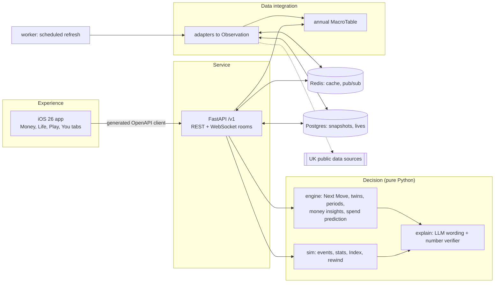
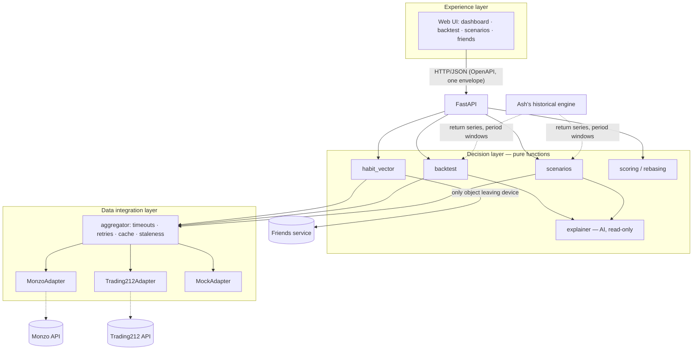

# Lifeline

**Many sources. One answer: your next money move. Play it before you live it.**

Lifeline answers one question: "What is my next money move?" It reads your money (sample bank data until bank connection ships), combines it with live UK data, and gives one move with its yearly value in £, its worst case and its evidence. "Test it" plays that move through a past shock in a life simulation before you make it in real life.

The life simulation is a BitLife-style game on real UK data. You live a full financial life, birth to death. Each AGE tap is one year. Events come from real data for that person, place and year: Bank Rate, mortgage rates, house prices, pay, unemployment, inflation.

GUTS Hackathon 2026 · BlackRock / Aladdin challenge: "One app. Every source. One clear decision." Aladdin stress tests portfolios. We stress test a life.

> **Not financial advice.** The Next Move and the Real-life Decision are education. They show how people like you did in similar past periods. They are not a forecast or a recommendation.

## The app

Four tabs (ADR 0016). The app always opens on Money.

| Tab | What it does |
|---|---|
| **Money** | Balance and net worth over time, spending by category, subscriptions with price-rise flags, bills for the next 30 days, budgets, savings goals, "Guess my spend". The **Next Move** card is the first element. Data is labelled "Sample data" until bank OAuth (Tier 2). |
| **Life** | The game. Character select (Play yourself, Random, God Mode, presets), AGE, event sheets, action menus (Job, Assets, People, Money, Activities), lessons, rewind, life summary, Real-life Decision. |
| **Play** | Same Life rooms (Tier 2), challenges, ribbons, the collection of lesson concepts. |
| **You** | Profile, bank connection, settings. |

## Next Move

`GET /v1/next-move` returns one top move and up to two runners-up (ADR 0018). The engine computes every number; the LLM may only reword the text, and a verifier rejects any new number (ADR 0019).

1. **Candidates.** The engine (`lifeline_engine`, no LLM) lists moves the data supports: fix or remortgage, move savings, cancel or switch a subscription, switch energy, pay off debt, build an emergency fund, cut a budget.
2. **Score.** For each option it simulates 20 similar people ("twins") through 5 matched past periods plus a standard stress period (mortgages: 2021-2023 rate shock). Options are chosen by regret: `expected - 0.5 x worst regret` (ADR 0020).
3. **Card.** Action, deadline ("Your deal ends in 165 days"), expected £ a year, worst case, confidence ("In 8 of 10 similar cases this was the best choice"), 3 evidence points, sources with live, cached or mock status.
4. **Test it.** `POST /v1/next-move/test` plays your real profile through the stress period once per option, on the same seed, and stores each run as a life. The card and Test it can disagree; the evidence says why (for example "a tracker saved £4,841 a year, though fixing for 5 years saved £7,828").
5. **Why?** The lesson for the move's concept, with one sentence about your own numbers.
6. **Do this.** `POST /v1/plan` adds the move to your plan.

## Accuracy (honest)

All figures below use labelled fixture data and the mock macro table. They describe our sample personas, not real users. Details: [docs/prediction.md](docs/prediction.md). We did not tune the engine to beat the baselines (ADR 0023).

Mortgage choice (fix 2 years, fix 5 years or tracker), walk-forward over 28 past deal-end years, 1995 to 2022:

| Method | Right choice |
|---|---|
| Next Move engine | 64.3% |
| Real-life Decision engine (`/v1/evaluation`) | 71.4% |
| Baseline: always fix for 2 years | 14.3% |
| Best constant rule: always take a tracker | 71.4% |

- The engines beat the naive 2-year baseline.
- Neither beats "always take a tracker" on this data. The Decision engine recommends a tracker in all 28 years, so it only ties that rule. The Next Move engine moves some years away from the tracker because of its stress-period penalty, and loses 7.1 points to the rule.

Daily spend prediction (ridge regression, ADR 0017), walk-forward over 90 days, mean absolute error (MAE):

| Persona | Model MAE | Weekday-average MAE | Result |
|---|---|---|---|
| homeowner-leeds | £28.74 | £26.93 | Model loses by £1.81 |
| renter-saver-london | £17.46 | £20.22 | Model wins by £2.76 |
| subscription-creep-manchester | £19.28 | £22.37 | Model wins by £3.09 |
| overspender-bristol | £19.80 | £21.62 | Model wins by £1.82 |

- The model wins for 3 of 4 personas. It loses for homeowner-leeds, which has large weekend spend and 26% of days with no spend.
- The 10% to 90% range holds 69% to 82% of days (target about 80%).

> **Two plans in one repo.** `BUILD_SPEC.md` defines the product we are building (this section). The team's original README for the "Play yourself" web layer follows below, unchanged. Where the two differ, `BUILD_SPEC.md` wins. `docs/STATUS.md` lists each difference.

## Run it (one command)

Needs Docker (Docker Desktop or Colima with the compose plugin), `make`, and `uv` for local tests.

```bash
make up          # copies .env.example to .env if missing, builds, starts api + worker + postgres + redis, waits for /v1/health
make demo-seed   # seeds Next Move, Test it, plan and demo lives for device demo-presenter-01 (see docs/DEMO.md)
make test        # Python unit, contract and integration tests (offline, recorded fixtures)
make down        # stop
```

- API: http://localhost:8000. Contract: `contracts/openapi.yaml`.
- No keys are needed. A source with a missing key serves clearly labelled mock data with `status: "mock"`.
- iOS app: `make ios-gen`, then open `apps/ios/Lifeline.xcodeproj`, or run `make ios-test`. Needs Xcode with the iOS 26 SDK and XcodeGen. Default simulator: iPhone 18 Pro Max (`SIM="..."` to override).
- UI work without a backend: run the `Playground` scheme in Xcode.
- Other targets: `make help`.

## Architecture

Three layers, joined by a FastAPI service. Full description: [docs/architecture.md](docs/architecture.md).



- The app talks only to our backend. It holds no keys or tokens.
- iOS code is split into pure Views and ViewModels (ADR 0011). Views and `DesignSystem` are owned by the UI owner (a human); agents own ViewModels, glue and networking, and ask for view changes in [docs/UI_REQUESTS.md](docs/UI_REQUESTS.md).
- Networking goes through `LifelineClient`: `LiveClient` calls the API, `MockClient` serves contract examples with no backend. The `Playground` scheme opens a gallery of every screen on `MockClient`.
- `lifeline_engine` and `lifeline_sim` are pure: no network, database or clock. Same data plus same seed gives the same life.
- The LLM writes wording only. The engine decides every outcome and number. A verifier checks every number in LLM text against engine facts; any mismatch falls back to the template (ADR 0019).
- Money tab data feeds "Play yourself" and the Next Move through one profile (`/v1/finance/profile`), so the card, the Money tab and the game agree.

## Trade-offs

| Decision | Why | Cost |
|---|---|---|
| Contract generated from Pydantic models (ADR 0002) | One source of truth for backend, tests and the Swift client; examples always validate | A model change needs `make contract` and a client regeneration |
| Pure decision core over an annual `MacroTable` (ADR 0005) | Deterministic lives, fast tests, replay and rewind use the same numbers | Sub-annual detail is lost; one AGE tap is one year |
| Redis TTL cache plus Postgres last-good snapshot | The game keeps working when a source is slow or down (`cached`) | Data can be up to one TTL old; the UI must show status |
| Labelled mock data when a key is missing | Runs with zero setup; demo never blocks on keys | Mock numbers are not real; every screen shows `mock` |
| UK average when a source excludes Scotland | Every region gets a value | Less local accuracy; the event says "UK average used" |
| Index against an autopilot twin, income-normalised | Fair comparison across rich and poor lives | Harder to explain than raw net worth; documented in `docs/index.md` |
| LLM for wording only, with a number verifier and templates | Numbers stay auditable; no invented figures | Less varied text when the LLM fails or a number does not match |
| Native iOS only, no web client | Liquid Glass, StoreKit, Sign in with Apple, widgets | No Android or browser play |
| Bank OAuth on the backend (state + PKCE) | Tokens never reach the device | Needs a public callback URL for real banks; sandbox only for now |
| Next Move risk includes a fixed stress period, options chosen by regret (ADR 0020) | The card and "Test it" tell one story; a move that fails a 2022-style shock is penalised openly | Can rank below the best constant rule on calm-period data (see Accuracy) |
| Ridge regression for daily spend (ADR 0017) | Exact £ reasons per feature group; fits 6 to 12 months of data | Loses to the weekday average for one persona |
| Fixture bank personas until bank OAuth (ADR 0021) | The Money tab and Next Move work with zero keys | All Money data is sample data, labelled |
| Two-stage non-root Docker image with `uv sync --frozen` | Reproducible builds from `uv.lock`; smaller attack surface | Image is about 480 MB because of numpy and the Anthropic SDK |

## API conventions

- Versioned under `/v1`. The contract is `contracts/openapi.yaml`, with examples for every endpoint.
- Success bodies are the resource itself (no envelope).
- **Errors use one format everywhere, as `BUILD_SPEC.md` requires:**
  ```json
  { "error": { "code": "not_found", "message": "Life lf_x not found.", "source": "api" } }
  ```
  This replaces the `{data, error, meta}` envelope in the team README below (ADR 0003).
- Auth: `POST /v1/auth/demo` or `POST /v1/auth/apple` returns a JWT. Send it as `Authorization: Bearer ...`.

## Data sources and attributions

Machine-readable list: [`services/api/lifeline_data_attributions.json`](services/api/lifeline_data_attributions.json). Live status: `GET /v1/sources`.

| Source | Used for | Coverage | Key | Licence | Attribution |
|---|---|---|---|---|---|
| Bank of England IADB | Bank Rate (IUMBEDR), 2-year fix (IUMBV34), 5-year fix (IUMBV42), savings rate (IUMB6VJ), card rate (IUMCCTL), revert-to mortgage rate (IUMTLMV), tracker (IUMBV48) | UK | No | Bank of England terms | Source: Bank of England Statistical Interactive Database. |
| ONS time series and beta API | Inflation (D7G7), energy (D7GT), fuel (D7IO), rents (PIPR from 2016; IPHRP before) | UK | No | OGL v3.0 | Source: Office for National Statistics licensed under the Open Government Licence v3.0. |
| Nomis | Earnings (ASHE), unemployment (APS), Census 2021 tenure | GB; Census: England and Wales | No | OGL v3.0 | Source: Office for National Statistics via Nomis, OGL v3.0. |
| HM Land Registry UK HPI | House prices by region | UK incl. Scotland | No | OGL v3.0 | Contains HM Land Registry data © Crown copyright and database right 2026. |
| postcodes.io | Postcode to region | UK | No | MIT (service); OGL v3.0 (data) | Contains OS data and Royal Mail data © Crown copyright / Royal Mail copyright 2026. |
| GOV.UK bank holidays | Spend prediction feature | UK | No | OGL v3.0 | Contains public sector information licensed under the OGL v3.0 (GOV.UK). |
| Frankfurter | GBP exchange rates | Global | No | MIT (service); ECB rates | Exchange rates: European Central Bank, via Frankfurter. |
| CoinGecko | Crypto prices | Global | No | CoinGecko API terms | Crypto price data provided by CoinGecko. |
| Yahoo chart (unofficial) | FTSE All-Share (^FTAS) | Global | No | Yahoo terms; blocked from our network, so labelled mock (ADR 0021) | Market index data: Yahoo Finance. |
| FRED | UK 10-year gilt yield (IRLTLT01GBM156N) | UK | No | FRED terms (OECD series); times out from our network, so labelled mock | Source: OECD, retrieved from FRED, Federal Reserve Bank of St. Louis. |
| Octopus Energy | Energy tariff (Flexible dual-fuel quotes) | GB | No | Octopus API terms | Energy tariff data: Octopus Energy. |
| Carbon Intensity API | Grid carbon intensity | GB | No | CC BY 4.0 | Carbon Intensity API, NESO, CC BY 4.0. |
| Open-Meteo | Weather for the spend prediction | Global | No | CC BY 4.0 | Weather data by Open-Meteo.com. |
| Police UK | Burglary counts near a region point | England, Wales, NI | No | OGL v3.0 | Contains public sector information from data.police.uk, OGL v3.0. |
| Environment Agency flood API | Flood warnings | England | No | OGL v3.0 | Environment Agency flood and river level data from the real-time data API (Beta). |
| Companies House | Employer insolvency | UK | `COMPANIES_HOUSE_KEY` | OGL v3.0 | Contains Companies House data, OGL v3.0. |
| Adzuna | Job offers and salaries | UK | `ADZUNA_APP_ID`, `ADZUNA_APP_KEY` | Adzuna API terms | Jobs by Adzuna. |
| DVLA Vehicle Enquiry | Vehicle tax and emissions | GB | `DVLA_KEY` | DVLA VES API terms | Contains public sector information from DVLA. |
| DVSA MOT History | MOT fail rates | GB | `DVSA_MOT_KEY` | OGL v3.0 | Contains public sector information from DVSA, OGL v3.0. |
| DWP Stat-Xplore | Benefits | GB | `DWP_STATXPLORE_KEY` | OGL v3.0 | Source: DWP Stat-Xplore, OGL v3.0. |
| EPC register | Home energy ratings | England and Wales | `EPC_KEY` | OGL v3.0 (plus Royal Mail and OS for addresses) | Contains public sector information licensed under the OGL v3.0. |
| Fixture bank data | Money tab and Next Move until bank OAuth | Synthetic personas | No | Our own synthetic data | Sample data. Not a real bank account. |
| TrueLayer sandbox | "Play yourself" bank connection | UK sandbox | `OB_CLIENT_ID`, `OB_CLIENT_SECRET`, `OB_REDIRECT_URI` | TrueLayer developer terms | Bank connection powered by the TrueLayer sandbox. |

Where a source excludes Scotland, the app uses the UK average and says "UK average used" in the event detail.

## Demo

Full script with exact taps, API calls and fallbacks: [docs/DEMO.md](docs/DEMO.md). The demo narrates live engine output, not a fixed answer (ADR 0020).

0. Money tab, then the Next Move card ("Your deal ends in 165 days"), Test it through the 2021-2023 rate shock with all options side by side, Why?, then Do this.
1. Play a nurse (Leeds) and a banker (London) from 2006 through 2008: same crash, different lives.
2. A judge joins a Same Life room via QR and plays the 2021 to 2023 rate shock.
3. Rewind a bad choice. Show the other path and the Index difference.
4. Play yourself to today. The Real-life Decision screen shows one action, its evidence and source status.

## More docs

- [docs/architecture.md](docs/architecture.md): layers, runtime, request flow.
- [docs/prediction.md](docs/prediction.md): spend model and Next Move backtests.
- `docs/index.md`: the Index formula. `docs/RESPONSIBLE_AI.md`: where AI is used and how it is checked.
- [docs/AI_USAGE.md](docs/AI_USAGE.md): how Claude Code built this, and the AI-usage statement draft.
- [docs/adr/](docs/adr/): decision records. [docs/STATUS.md](docs/STATUS.md): progress, mocks, known issues.
- CI: `.github/workflows/ci.yml` runs ruff, mypy, pytest, a contract drift check, `docker compose build`, gitleaks and the iOS tests.

---

<!-- Team README (original, kept unchanged below). -->

# One app. Every source. One clear decision.

GUTS Hackathon 2026 (Glasgow, 17–18 Oct) · BlackRock / Aladdin challenge · team of 5

A UK personal-finance app. It pulls your own accounts into one view. Then it lets you **play yourself**: replay your real saving and investing habits through past market shocks, and compare modelled paths forward.

> **Status: early build.** This README describes what we're building. Anything marked *(planned)* doesn't exist yet. See [docs/PLAN.md](docs/PLAN.md) for the build order and open questions.

> **Not financial advice.** Every forward-looking output is a *modelled scenario based on similar past periods*. None of it is a forecast or a recommendation.

---

## What it does

| Area | Description | Owner |
|---|---|---|
| Dashboard | Bank balance, spending and ISA holdings in one view | Yath |
| Backtest | Run your real contribution habits through 2008, COVID and 2022 with different allocation splits (DCA vs lump sum, rebalancing rules) | Yath |
| Future insight | A fan of outcomes from past periods with similar starting conditions | Yath |
| Friends | Compete on scores and values rebased to 100. Opt-in pie of your invested-assets split. Never £ amounts | Yath |
| Historical engine | Synthetic UK population, twin matching, past-period replay, gamified life loop | Ash |

## Data sources

All sources are the user's own accounts, accessed **read-only**:

- **Monzo API**: balances, pots and transactions (OAuth 2.0 or playground token)
- **Trading212 API**: Stocks & Shares ISA holdings and cash

Each source sits behind a `FinanceAdapter`. A `MockAdapter` implements the same interface with deterministic personas, so the app runs fully offline. Mock mode is the default.

## Privacy model

- Raw transactions, balances and holdings **stay on the device**.
- `habit_vector()` is the only thing that leaves it. It holds ratios and 0–100 scores, never £ amounts:
  - savings rate
  - runway (months)
  - spend stability
  - discretionary share
  - subscription creep
  - ISA diversification (HHI)
  - shock resilience
- The friends feature only shows values rebased to 100. Sharing your allocation pie (percentages only) is opt-in.

## Architecture



### Trade-offs (draft)

| Decision | Why | Cost |
|---|---|---|
| One adapter interface with capability flags, rather than one interface per source type | The mock can stand in for any source, and the aggregator stays simple | Some methods raise `UnsupportedCapability` on some adapters |
| Money stored as integer pence | No float rounding errors in sums or caps | Values are converted at the edges for display |
| Decision layer is pure, with no I/O | Fast deterministic tests. Easy to reason about | The aggregator has to fetch everything up front |
| Partial results plus a stale cache instead of hard failure | The demo survives a slow or failing API | The UI has to show which sources are stale |
| Time-weighted return index rebased to 100 for comparisons | People with different incomes can be compared fairly and privately | Hides absolute outcomes, which stay local only |
| Synthetic returns first, real series later | Unblocks the backtest immediately | Early results are illustrative only |
| AI explains results but never decides | Numbers stay auditable. No hallucinated figures | Explanations are less flexible. Template fallback when offline |

## API conventions *(planned)*

- Versioned under `/v1`. The spec is served at `/openapi.json` and exported to `docs/openapi.json`.
- Every response, including errors, uses one envelope:

```json
{ "data": { }, "error": null, "meta": { "request_id": "…", "as_of": "…", "stale": false, "sources": { } } }
```

```json
{ "data": null, "error": { "code": "source_timeout", "message": "…", "details": { } }, "meta": { } }
```

## Quick start *(planned)*

```bash
cp .env.example .env   # mock mode by default, no credentials needed
make run               # installs deps and starts the API + UI on mock data
make test              # unit + integration tests
make lint              # ruff lint + format check
```

## Configuration

All configuration comes from environment variables. No secrets are stored in code. `.env` is gitignored, and `.env.example` lists every variable *(planned)*.

| Variable | Purpose |
|---|---|
| `MONZO_MODE` / `T212_MODE` | `mock` (default) or `live`, set per source |
| `MONZO_ACCESS_TOKEN` | Monzo token (live mode only) |
| `T212_API_KEY` | Trading212 API key (live mode only) |
| `SOURCE_TIMEOUT_SECONDS` | Timeout for each source fetch |
| `ISA_ALLOWANCE_PENCE` | Annual ISA allowance used by the backtest |

## Testing

- **Unit tests**:
  - each `habit_vector` factor, with hand-computed fixtures
  - backtest maths (closed-form checks, ISA cap)
  - scoring and rebasing
  - the response envelope
- **Contract tests**: every adapter satisfies `FinanceAdapter`.
- **Integration test**: API → aggregator → mock adapters, end to end.
- **Privacy test**: `habit_vector` output contains no monetary values.

## Project layout *(planned)*

```
src/playyourself/   adapters/ · domain/ · decision/ · api/ · settings.py
data/mock/          personas and synthetic return series (clearly labelled)
tests/              unit/ · integration/
docs/               PLAN.md · architecture.md · openapi.json
```

## AI use (declaration)

- **In the product**: an LLM turns the engine's structured results into plain-English explanations. It never computes or changes figures, and its output is checked against the input numbers. A template fallback runs when no API key is set.
- **In development**: we used Claude Code to help with planning, scaffolding, documentation and code. A team member reviews all generated code.

## Team

| Name | Area |
|---|---|
| Yath | "Play yourself" layer: adapters, habit vector, backtest, scenarios, dashboard, friends |
| Ash | Historical engine: synthetic population, twin matching, past-period replay, life loop |
| TBC | TBC |
| TBC | TBC |
| TBC | TBC |
