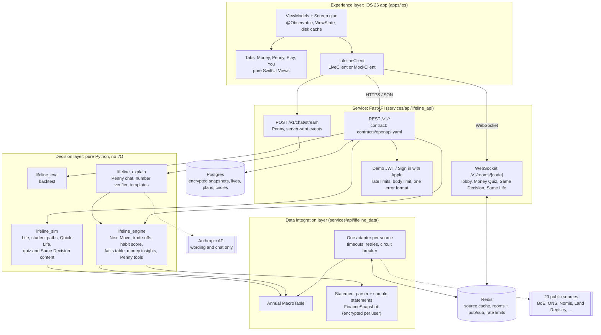

# Penny

**Rich or broke, it's about habits.**

GUTS Hackathon 2026 (24 hours). BlackRock / Aladdin challenge: "One app. Every source. One clear decision."

- This README is the submission checklist. Section 15 maps each brief requirement to its evidence.
- Product direction: [DIRECTION_V2.md](DIRECTION_V2.md) (ADRs 0046 to 0061) and the Penny V3 build (ADRs 0062 to 0075).
- Code names keep the earlier working name "Lifeline": bundle ids, the Xcode project, `LifelineClient`, the Python packages `lifeline_*` (ADR 0040).

> **Penny is AI and can make mistakes. Guidance only, not regulated financial advice. Check before big decisions.**

## 1. User story

**Who:** Eilidh Fraser, 19, University of Edinburgh. SAAS loan and bursary plus a café job. Shared flat in Marchmont.

- Money in: SAAS loan £1,044 a month, Young Students' Bursary £222 a month, café job about £87 a week.
- Money out: £650 a month rent plus a £35 energy and broadband share, phone, subscriptions, food and nights out.
- Her money arrives on different schedules, and the gap to the next payment changes each month.

**Her decision:** "Will my money last until my next payment, and how much can I spend each week?"

**The other 9 sample students show that the engine adapts** (ADR 0062). Each has different money in, rent and spending:

| Sample student | City | Money in |
|---|---|---|
| Eilidh Fraser (Scottish student) | Edinburgh | SAAS loan, Young Students' Bursary, café job |
| Amara Okoye (scholarship) | Sheffield | Maintenance loan, university bursary |
| Priya Patel (commuter) | Bolton | Maintenance loan, help from mum |
| Jordan Hughes (England loan) | Newcastle | Maintenance loan |
| Callum Reid (working student) | Leeds | Maintenance loan, bar job |
| Grace Mensah (mature, NHS course) | Birmingham | Maintenance loan, NHS Learning Support Fund, NHS bank shifts |
| Yutong Chen (international) | Coventry | Parents, by Wise |
| Sam Whitfield (final year) | Exeter | Summer internship, maintenance loan |
| Hugo Ashworth (rich student) | Leeds | Parents |
| Lena Novak (graduate) | London | First graduate salary |

- All 10 are synthetic and labelled "Sample" in the app. Their amounts are calibrated to the Save the Student National Student Money Survey 2026, the National Student Accommodation Survey 2026 and the official funding tables. Every figure and its source: [docs/seed_sources.md](docs/seed_sources.md).
- The engine computes each forecast again on every request. No result is stored in the sample.

## 2. The decision: the forecast

The Money tab answers Eilidh's question with one forecast card (ADR 0072): "Will my money last until my next payment, and how much can I spend?" The engine (`lifeline_engine/forecast.py`, `compute`) does every sum. No AI picks a number.

**The calculation** (`maths`):

1. **Money now:** current accounts from the statement. An overdraft counts as negative. Savings are not counted.
2. **Next money:** the next payment of the main income source, which is the recurring source with the largest amount a month (`income_plan`). Payments on the same day join it ("SAAS loan + bursary"). Smaller payments before it count as expected income.
3. **Bills:** recurring bills and subscriptions found in the statement (`lifeline_engine/money/recurring.py`), due from tomorrow to the day before the next money (`bills_between`).
4. **Buffer:** 10% of what is left, by default. The user can change it.
5. **Per day** = (money now + expected income - bills - buffer) / days, rounded down to the penny. **Per week** = per day x 7.
6. **Short window:** under 14 days to the next money, the card shows the total until that date ("You can spend £930 until 26 October"), not a weekly figure.
7. **Verdict:** usual spending (average of the last 4 weeks, no rent or bills) is compared with the safe amount. The result is "You'll make it to DATE" with the spare money, or "You could run out on DATE".

**The maths** screen shows the 4 steps with the real numbers: money now, bills before the next money, buffer, and what is left per day and per week.

**Detailed breakdown:** each account, each bill with its due date, the next money with its official payment schedule (SAAS, Student Finance England), the 4 weeks of usual spending, and every source. "Based on N sources" opens the sources hub (section 4.4).

**What-ifs through Penny:** "Can I afford a £60 concert on the 30th?" or "What if my loan is a week late?" Penny calls the `forecast_what_if` tool (`lifeline_explain/forecast_tool.py`). The engine runs the forecast again with the change and returns before and after. Penny explains the difference. Every number she says must match the engine (section 6).

**One suggestion under the forecast:** the earlier Next Move engine (`GET /v1/next-move`, `lifeline_engine/next_move.py`, ADR 0018) still ranks the options (safety fund, pay off expensive debt, Lifetime ISA, cut subscriptions, better savings rate) by gain, worst case and confidence. Each option states its trade-off (`lifeline_engine/trade_offs.py`, ADR 0042). The app shows the top one as one suggestion under the forecast.

Accuracy is reported as measured: [docs/prediction.md](docs/prediction.md) (ADR 0023).

## 3. Architecture

Full description: [docs/architecture.md](docs/architecture.md).



| Layer | Code | What it does |
|---|---|---|
| Experience | `apps/ios` | SwiftUI app, iOS 26. Tabs: Money, Penny, Play, You (ADR 0048). Talks only to our backend. Holds no keys. |
| Decision | `lifeline_engine`, `lifeline_sim`, `lifeline_eval`, `lifeline_explain` | `lifeline_engine` and `lifeline_sim` are pure: no network, no database, no clock, seeded RNG only. Same data and same seed give the same result. `lifeline_explain` writes the wording and checks every number. |
| Data integration | `lifeline_data` | One adapter per source. Each value has a status: `live`, `cached`, `unavailable` (`mock` only in demo mode). Redis cache, Postgres last-good copy, annual `MacroTable`. Statement parser and sample statements. |

A FastAPI service (`lifeline_api`) joins the layers. Errors use one format everywhere: `{"error": {"code": "...", "message": "...", "source": "..."}}`.

## 4. Data

### 4.1 Live market data

`GET /v1/sources` lists 20 sources (`served_sources()` in `services/api/lifeline_data/sources.py`). Status changes at run time. The endpoint is the source of truth.

Key: **D** = Next Move input (`DECISION_PROVIDERS` in `lifeline_engine/next_move.py`). **P** = Penny reads it through a tool. **C** = context only, never a decision input (ADR 0030). **G** = Life game or support.

| id | Source | What it supplies | Use |
|---|---|---|---|
| `boe` | Bank of England Database | Bank Rate, savings, mortgage and card rates | D, P |
| `ons` | Office for National Statistics | Inflation (CPI) and other UK statistics | D, P |
| `nomis` | Nomis (ONS labour market and Census) | Earnings (ASHE) and unemployment by region | D, G |
| `landregistry` | HM Land Registry UK House Price Index | House prices by region | D |
| `companieshouse` | Companies House API | Counts of companies in liquidation and administration | D |
| `octopus` | Octopus Energy products API | Energy tariffs | D |
| `frankfurter` | Frankfurter FX rates (ECB reference rates) | Exchange rates; Penny's currency conversion | D, P |
| `coingecko` | CoinGecko | Crypto prices | D |
| `postcodes` | postcodes.io | Postcode to region | G |
| `bankholidays` | GOV.UK bank holidays | Bank holidays (spending context) | G |
| `openmeteo` | Open-Meteo | Daily weather (spending context) | G |
| `yahoo` | Yahoo Finance chart endpoint | Monthly stock market history | G |
| `fred` | FRED, Federal Reserve Bank of St. Louis | UK 10-year government bond yield (OECD series) | G |
| `carbonintensity` | Carbon Intensity API | Regional grid carbon intensity | G |
| `police` | Police UK data API | Burglary counts by area | G |
| `environmentagency` | Environment Agency flood monitoring API | Flood warnings | G |
| `statxplore` | DWP Stat-Xplore | Universal Credit caseload, Great Britain | G |
| `epc` | Energy Performance of Buildings register | Share of homes rated A to C by region | G |
| `guardian` | The Guardian Open Platform | Headlines and links only | C, P |
| `boe-mpc` | Bank of England MPC dates | Next Bank Rate decision date | C, P |

- Penny can also call the Next Move, Test it and finance tools, so every D source reaches her answers through the engine.
- Status checks:
  - Local stack, 2026-10-17 22:50 UTC: 18 `live`, 2 `mock` (`yahoo`, `fred`; demo mode).
  - Railway, after the V2 deploy: 20 sources, 17 `live`, `landregistry` `cached`, `yahoo` and `fred` `unavailable`.
- **No fake data in live mode** (ADR 0027). A source with no live or cached real data reports `unavailable`. Its values are absent from the `MacroTable`. The app shows "Unavailable".
- **"Based on N sources" counts decision sources only** (ADR 0032). An unavailable source is listed but not counted. Context and game sources are never counted.
- Cut from the product (ADR 0046): Adzuna, DVLA, DVSA MOT, Open Banking sandbox (TrueLayer). Their adapters stay in the code. `/v1/sources` does not list them.
- Attribution text: `attribution` in `/v1/sources` and [`services/api/lifeline_data_attributions.json`](services/api/lifeline_data_attributions.json).

### 4.2 Personal data

The user picks one of three inputs in onboarding, under "Connect your money" (ADR 0047, 0049):

| Input | How | Route |
|---|---|---|
| Upload a statement | Monzo or Revolut CSV. PDF statements are also read; a bank PDF with embedded fonts fails with a clear message to upload the CSV. Max 5 MB, 20,000 rows. | `POST /v1/finance/statements` |
| Enter your numbers | Student or working, age, postcode, housing, income sources (amount and schedule each), student loan plan, regular costs, savings, debts (card, overdraft, BNPL) | `PUT /v1/finance/manual` |
| Use a sample statement | One of 10 sample student cards | `GET /v1/samples`, `POST /v1/samples/{id}/import` |

- Sample statements are synthetic and labelled "Sample". Each is a CSV and a PDF with a running balance. Files: `demo/statements/`. Generator: `tools/gen_statements.py` (deterministic, no network). Calibration: National Student Money Survey 2026 and the other sources in [docs/seed_sources.md](docs/seed_sources.md).
- Sample snapshots carry `source="sample"`. The app labels them "Sample data".
- Every input becomes the same `FinanceSnapshot`. It is stored encrypted in Postgres (section 13).

### 4.3 Why no bank connection

Penny does not connect to banks. Each route was checked and closed for a student app built in 24 hours:

- **Monzo API:** for personal use only. A public app cannot use it for other customers.
- **Open Banking:** needs FCA authorisation, or a contract with an authorised aggregator.
- **GoCardless Bank Account Data:** closed to new signups in 2025.
- **Apple FinanceKit:** needs a special entitlement from Apple.

Statement upload produces the same `FinanceSnapshot` format as a bank feed. A licensed feed can plug in later with no change to the engine.

### 4.4 Sources hub

"Where Penny's data comes from" (ADR 0073). `GET /v1/sources/hub` and one app screen, opened from the forecast card ("Based on N sources"), from The maths and from You.

- Top line: "Penny uses your statement plus N live UK sources. Here is what each one does."
- One card per student-facing source: your statement, official facts, Bank of England, ONS, Nomis, Octopus Energy, Frankfurter, Bank of England MPC dates.
- Each card shows the status (live, saved copy or sample) with its time, what it gives Penny and which screens use it. A tap shows the latest values and a link to the official page.
- No homeowner sources (Land Registry, EPC, mortgages).

## 5. Official facts

Every rule number comes from an official source (ADR 0058).

- **69 official amounts in total:** 55 facts in the facts table and 14 in the Life game tables.
- **Facts table:** `services/api/lifeline_engine/rules.py`. 55 facts for the 2026/27 tax year. Each fact stores its official URL and the date it was checked (`checked="2026-10-17"`).
- **Topics:** ISA and Lifetime ISA (11), income tax (8), Scottish income tax (11), National Insurance (4), student loans (11), student finance and maintenance loan schedule (5), council tax (2), 16-25 Railcard (3).
- **Life game amounts:** `services/api/lifeline_sim/paths.py` adds 14 dated official amounts: tuition fee caps from 2006 to 2027 (legislation.gov.uk and gov.uk) and the Master's Loan maximum for 2024 to 2026 (gov.uk). Each has a URL and a checked date.
- **Allowed domains:** gov.uk (including HMRC, Student Finance England and SLC guidance), saas.gov.uk, studentfinancewales.co.uk, studentfinanceni.co.uk, railcard.co.uk, 16-25railcard.co.uk, legislation.gov.uk, bankofengland.co.uk. Money Quiz sources may also use ons.gov.uk and nomisweb.co.uk (ADR 0058 amendment).

How Penny looks up a rule (tax, student loans, ISAs, benefits, council tax, Railcard), in `lifeline_explain/official.py`:

1. Read the facts table first. Show the official URL and "checked DATE" in the sources.
2. If the fact is not in the table, run web search on the allowed domains only. Quote a number only if it appears in the official page text that came back.
3. If no official page states it, say so and give no number.

## 6. Penny

Penny is a full tab (ADR 0051). One chat, two labelled answer modes. The mode depends on what Penny used (`ChatResponse.mode`).

**Scope (ADR 0073):** money and student life.

- Money: budgets, loans, rent, bills, jobs and pay, saving, banking, bursaries, costs of student life. Strict number check.
- Student life: uni services, studying, housing, getting around, wellbeing services, societies, moving to a new city. "General knowledge" label, relaxed number check. A money angle is added in one line where it fits.
- Anything else (coding, homework, celebrity news) gets one friendly line and 2 suggestion chips. A fixed rule decides this before the model runs (`lifeline_explain/scope.py`).

| Mode | Label | When | Check |
|---|---|---|---|
| `checked` | "Checked with your data" | Penny used an engine tool | The verifier checks every number against the tool facts, with its unit (£ or %) |
| `general` | "General knowledge" | No engine tool. Student-life questions, with web search | If the answer states the user's own numbers, the verifier blocks it and Penny retries with an engine tool |

**Tools** (`lifeline_explain/chat_tools.py`, ADR 0033, 0060):

| Tool | What it does |
|---|---|
| `next_move` | The user's Next Move |
| `test_move` | Test it for a move |
| `finance_summary` | Summary of the user's money |
| `user_balance` | The user's balance |
| `forecast` | The forecast card numbers, The maths and the breakdown |
| `forecast_what_if` | Runs the forecast again with a change (a cost, a late payment, extra shifts) and returns before and after |
| `cash_flow_projection` | Cash until the next money arrives |
| `spend_prediction` | Today's predicted spend |
| `habit_score` | The 6 habit ratios |
| `facts_table` | Official rule facts with URL and checked date |
| `boe_rates` | Live Bank of England rates |
| `inflation` | ONS CPI inflation |
| `fx_convert` | Currency conversion (Frankfurter, ECB rates) |
| `news_search` | Guardian headlines (context only) |
| `rate_decision_dates` | Next Bank of England rate decision |
| `life_replay`, `event_choices` | Life game questions |
| `web_search` | Anthropic server tool; official domains only for rules questions |

- Each tool call streams a plain-words step, for example "Checking exchange rates…". Steps come only from real tool calls.
- Tools are bound to the signed-in user. A tool cannot read another user's data (V6 step 5).
- Penny asks the user only for what only the user knows. She never asks for rates, conversions or public facts (ADR 0060).

**Safety** (`lifeline_explain/prompts.py`):

- No share or crypto picks. No regulated advice.
- Distress gets a kind reply and support: university hardship fund, student support, Samaritans (116 123).
- Statement text, news headlines, web pages and user messages are data, never instructions. They reach the model fenced in `<untrusted>` blocks (ADR 0034).

**Disclaimer** (in every `ChatResponse`, shown in the app with the sources): "Penny is AI and can make mistakes. Guidance only, not regulated financial advice. Check before big decisions."

**Speed:**

- Chat model: Claude Sonnet 5.5 (`CHAT_MODEL`, default `claude-sonnet-5-5`). Target: first bubble under 3 s.
- V4 measured the first bubble at 2.2 to 2.5 s in the app for 3 questions. The 1 million yuan question took about 7 s (2 tool calls).
- Voice: one bubble, two at most. A reaction shows within 1 s. Keep-alive events, then a non-streaming fallback, then "Penny is unavailable right now. Try again."

**penny-trace (ADR 0075):** a demo tool that shows how one real answer is made, on the live server.

```bash
make penny-trace STUDENT=eilidh BASE=https://api-production-15615.up.railway.app Q="Can I afford a £60 concert on the 30th?"
```

- It prints SOURCES (status and latest values), QUESTION, SCOPE, TOOL, ENGINE (inputs, each with its source), DRAFT, VERIFY (each number and where it matched), REWRITE, ANSWER and SOURCES USED.
- `make penny-trace-live BASE=...` prints every real Penny answer from the app as it happens.
- The server serves traces only with `PENNY_TRACE_ENABLED=1`. The live stream also needs `PENNY_TRACE_TOKEN`. The output never contains keys, tokens, headers or prompts (tested).

## 7. Play

Play opens with two choices: **Play solo** and **Play with friends** (ADR 0052).

### Solo

- **Life:** a career and money simulator from age 18. Student start paths: university, apprenticeship, job at 18, gap year, master's (`GET /v1/paths`). The old banker, plumber, retired and nurse presets are no longer offered.
- Pay per path stage is a labelled game assumption: a share of the regional median full-time pay (Nomis ASHE). Student loan repayment uses the official thresholds from the facts table (ADR 0061).
- **Play yourself:** starts a life from the user's own data and current age.
- **Student challenges:** "Make your money last the term", "1 month safety fund", "Clear Klarna", "Lifetime ISA by 25".
- **Quick Life:** ages 18 to 25 in 5 or 6 taps, 2 or 3 events with choices, then a summary card with a habit score. Game money only. The API runs it with `POST /v1/lives` and `quick: true`. The app offers it as a Same Life round in the lobby.

### With friends

1. Tap "Play with friends". The lobby opens with a QR code and a short code.
2. Friends scan the QR or type the code. Their names come from their accounts.
3. The host picks a game and its options on one sheet.
4. Start. 2 players play a duel. More players play as a group.

| Game | What happens |
|---|---|
| **Money Quiz** | Questions from lessons and the facts table, each with its source. 15 s per answer. Live ranking. Penny explains each answer in one line. 59 questions: 42 from the facts table, 17 from lessons, each with a source URL (`lifeline_sim/quiz.py`). |
| **Same Decision** | Everyone faces the same student money decision in the same year of real history (14 prompts, 2007 to 2023, `lifeline_sim/decisions.py`). Reveal of choices and outcomes in game money. |
| **Same Life** | Everyone plays the same life on the same seed, with live rival updates. Quick Life is the short version. |

### Circles

- Friends in a Circle share **habit scores only**: savings rate, months of cover, spend stability, discretionary share, subscription creep, debt pressure. Each is a ratio from 0 to 100, computed by the engine (`HabitScore` in `lifeline_contracts/domain.py`).
- The leaderboard ranks improvement against each member's own first score.
- Penny posts a weekly recap with ratios only.
- **Privacy rule:** no £ amount, balance, income, transaction or merchant leaves the user's own view. The contract test `test_shared_payloads_never_carry_personal_money` enforces it. V6 scanned every room, Circle and challenge payload for 4 players and found 0 personal amounts.

## 8. API contract

- File: [`contracts/openapi.yaml`](contracts/openapi.yaml), versioned under `/v1`.
- It is generated from the Pydantic models in `services/api/lifeline_contracts/` (ADR 0002). Do not edit it by hand. Regenerate with `make contract`.
- The iOS client is generated from the same file by `swift-openapi-generator`.
- Auth: `POST /v1/auth/demo` or `POST /v1/auth/apple` returns a JWT. Send it as `Authorization: Bearer ...`.

## 9. How to run

Prerequisites:

- Docker (Docker Desktop, or Colima with the compose plugin) and `make`.
- `uv` for Python tests and lint.
- For iOS: Xcode with the iOS 26 SDK, and XcodeGen.
- No API keys are needed to start. A missing key makes that source `mock` (demo mode) or `unavailable` (live mode).

Backend:

```bash
make up     # copies .env.example to .env if missing, starts api, worker, postgres, redis, waits for /v1/health
make test   # Python tests (offline, recorded fixtures)
make down   # stop
```

- API: http://localhost:8000. Health: `GET /v1/health`. All targets: `make help`.
- Local default is demo mode (`DATA_MODE=demo`). Set `DATA_MODE=live` in `.env` for live mode.

iOS:

```bash
make ios-gen    # copies the contract into the app and generates Lifeline.xcodeproj
make ios-test   # unit and UI tests on the simulator
```

| Configuration | Client | Backend |
|---|---|---|
| `Debug` | `LiveClient` | http://localhost:8000 |
| `Mock` | `MockClient`, recorded responses | none |
| `Demo` | `LiveClient` | Railway |
| `Dev` | `LiveClient`, app "Penny Dev" | Railway |
| `Release` | `LiveClient` | as set |

- Schemes: `Lifeline` (Debug, with tests) and `Playground` (Mock, `-playground`: a gallery of every screen).
- Phone build: `make ios-device CONFIG=Mock` or `CONFIG=Demo`. It needs `apps/ios/Config/Local.xcconfig` with your team (ADR 0015).
- Judge mode: You tab > "New player" starts a fresh demo account and onboarding. "Reset demo" clears the demo data and returns to Welcome.

Hosted API (Railway, `DATA_MODE=live`, ADR 0028): https://api-production-15615.up.railway.app

- Railway runs the Direction V2 backend (deployed 2026-10-17, 23:55 local time). `/v1/paths` answers 401 without a token. `/v1/sources` lists 20 sources.
- Smoke test after the deploy: 4 sample imports took 0.36 to 1.44 s. `GET /v1/next-move` took 2.3 to 2.4 s.

## 10. Tests and verifiers

| Suite | Path | Command |
|---|---|---|
| Unit (Python) | `services/api/tests/unit/{api,data,engine,eval,explain,sim}` | `make test` |
| Integration (HTTP and WebSocket) | `services/api/tests/integration` | `make test` |
| Contract (responses against `openapi.yaml`) | `services/api/tests/contract` | `make test`; against the stack: `make test-stack` |
| Lint and types | ruff, `mypy --strict`, AI disclosure copy in sync | `make lint` |
| iOS unit and UI | `apps/ios/LifelineTests`, `apps/ios/LifelineUITests` | `make ios-test` |
| Secrets | gitleaks over the working tree | `make secrets-scan` |

- Server (`make test`): 2,325 passed, 1 skipped, on `main` (18 Oct 2026, about 80 s). With the live trace commit: 2,341 passed.
- iOS (`make ios-test`): 395 tests in 45 suites passed, plus the UI tests (`LifelineUITests`), on `main` (18 Oct 2026).
- Python tests never call the network. They use recorded fixtures under `services/api/tests/fixtures/`.
- CI: `.github/workflows/ci.yml` runs ruff, mypy, the 3 pytest suites, the contract check and `docker compose build`.

Verifiers are separate agents. They check the work and write reports to [docs/verify/](docs/verify/). Final run on 18 Oct 2026 (Penny V3 build), all passing:

| Verifier | Report | Verdict |
|---|---|---|
| V1 contract | [V1-final.md](docs/verify/V1-final.md) | PASS |
| V2 engine | [V2-final.md](docs/verify/V2-final.md) | PASS (2 non-blocking warnings) |
| V3 resilience | [V3-final.md](docs/verify/V3-final.md) | PASS |
| V4 iOS | [V4-final.md](docs/verify/V4-final.md) | PASS |
| V5 demo | [V5-final.md](docs/verify/V5-final.md) | PASS after the what-if speed fix (`e73b4f72`, re-checked 09:48) |
| V6 security | [V6.md](docs/verify/V6.md) | PASS |
| V7 final | [V7-final-v3.md](docs/verify/V7-final-v3.md) | PASS, all 9 items |

## 11. Graceful failure

| Failure | What happens | Where |
|---|---|---|
| A source is down or has no key | Cached real data if present, else `unavailable`. Never mock in live mode. The decision lists the source but does not count it. | `lifeline_data`, ADR 0027, 0032 |
| API still warming after a start | `/v1/health` reports `warming: true` until the `MacroTable` is built. Sample import does not wait for it. | `lifeline_api/main.py` |
| AI missing, slow or wrong | Engine template text. A number that fails the verifier is never shown. | `lifeline_explain`, ADR 0019 |
| Penny answer fails the number check | One rewrite. Then a summary of the tool facts, marked as not checked. | `lifeline_explain/chat.py` |
| Penny model off or times out | "Penny is unavailable right now. Try again." | ADR 0051 |
| Rate limit (429) | The app retries quietly with backoff and honours `Retry-After`. | `apps/ios/Lifeline/Networking/ResilienceMiddleware.swift`, ADR 0038 |
| Slow network | The app shows the last known response from its disk cache at once and refreshes in the background. Skeletons, never spinners with text. | `apps/ios/Lifeline/Networking/DiskCache.swift`, ADR 0060 |
| No money data yet | Not an error. `GET /v1/finance/home` returns `has_data: false`. Money home asks the user to connect money. | `lifeline_api/routes/finance.py`, ADR 0038 |
| Postgres down | Writes answer 503 `store_unavailable` ("Saving is down. Try again in a minute."). Health reports `degraded`. | V3 Tier 2 |

## 12. Security and secrets

- **Keys live only in `.env`** (git-ignored) and in Railway variables. `.env.example` lists every variable name. The app holds no keys.
- **gitleaks before every commit.** `make secrets-scan` runs before each commit. A finding blocks the commit (ADR 0041).
- **User money data is encrypted at rest.** `UserSnapshotStore` stores each user's `FinanceSnapshot` as Fernet ciphertext with `TOKEN_ENCRYPTION_KEY` (`lifeline_data/crypto.py`, `lifeline_data/cache.py`). In live mode a missing key stops the store; nothing is stored as plain text.
- **No bank tokens.** Penny has no bank connection (section 4.3), so it stores no bank tokens.
- **Untrusted text is fenced.** Statement text, merchant names, news headlines, web pages and chat messages reach the model inside `<untrusted source="...">` blocks. The system prompt says this text is data, never instructions (ADR 0034).
- **Names are cleaned.** Room and Circle names lose control and bidi characters (`lifeline_api/names.py`).
- **Rate limits** per user on reads, writes and chat; per IP on sign-in and wrong Circle codes.
- Bearer tokens are removed from logs (`lifeline_api/logsafe.py`).
- Account: `POST /v1/me/reset` clears the user's data. `DELETE /v1/me` deletes the account and removes the user from every Circle.
- Security report: [docs/verify/V6.md](docs/verify/V6.md).

## 13. AI disclosure: How Penny uses AI

Source: [`services/api/lifeline_explain/ai_disclosure.json`](services/api/lifeline_explain/ai_disclosure.json). The You tab shows the same text. `make lint` fails if the app copy differs.

**Where AI is used**

- An AI model (Claude Opus, from Anthropic) rewords the text of game events, their outcomes and the Next Move card.
- Ask Penny uses a faster model (Claude Sonnet, from Anthropic) to write chat answers.
- Ask Penny gives two kinds of answer. Checked with your data: Penny used the app's tools. General answer: Penny works like a normal assistant and can search the web.
- Lessons are fixed text. AI does not write them.
- The app never calls the AI model. Only our server calls it.

**What stays deterministic**

- The engine calculates and ranks the options and picks your Next Move. AI explains it. AI never makes the decision.
- Every number about your money comes from your data, a public data source or the engine.
- The engine writes the trade-off of each move (What you give up). Penny can only say it in other words.
- The game engine decides every event, outcome and money change. The same seed gives the same game.

**How output is checked**

- Checked with your data: a number verifier checks every number against the facts from the app's tools. It also checks the unit: a money fact needs a £ sign and a percent fact needs a % sign. Code: `services/api/lifeline_explain/verifier.py`.
- General answer: Penny must not state your own money numbers. If she does, the app blocks the answer and Penny tries again with the app's tools. Web sources are shown under the answer.
- Rules questions: Penny uses the facts table first and shows the official page and the date it was checked. If the rule is not there, she searches official sites only and quotes a number only if the official page states it. Otherwise she says so and gives no number.
- Penny must not say she has no live data. The app has live Bank of England rates, and a test checks this rule.
- Safety: Penny does not pick shares or crypto and does not give regulated advice. If you sound in distress, she replies kindly and points to your university hardship fund, student support and Samaritans (116 123).
- Prompt injection tests put hostile text in statements, news headlines and user messages. The tests check that hostile text cannot change a rule or add a number.
- Golden tests: `services/api/tests/unit/explain/test_chat.py`, `test_chat_v2.py`, `test_chat_v6_direction.py`, `test_official_sources.py`. Verifier tests: `test_explain.py`, `test_trade_off.py`.

**What happens when AI fails**

- No AI key, an AI error or a failed check: events, outcomes and the Next Move card show the engine's template text. The template text is complete and correct.
- If a checked answer fails the number check, Penny gets one rewrite. If it fails again, Penny shows a summary of the tool facts, marked as not checked.
- If the AI model is off, times out or fails before any tool runs, the chat shows: "Penny is unavailable right now. Try again."
- By default, each AI call stops after 12 seconds and an Ask Penny answer stops after 24 seconds.
- A number that fails the check is never shown.

How we used AI to build Penny (Claude Code agents, verifiers, gates): [docs/AI_USAGE.md](docs/AI_USAGE.md). Product rules: [docs/RESPONSIBLE_AI.md](docs/RESPONSIBLE_AI.md).

## 14. Decisions

Every decision is an Architecture Decision Record (ADR) in [docs/adr/](docs/adr/). ADRs 0046 to 0061 record Direction V2 and supersede earlier ADRs where they conflict.

| ADR | Decision |
|---|---|
| [0001](docs/adr/0001-record-decisions.md) | Record decisions as ADRs |
| [0002](docs/adr/0002-contract-generated-from-pydantic.md) | Generate `openapi.yaml` from shared Pydantic models |
| [0003](docs/adr/0003-spec-file-name-and-existing-repo.md) | Spec file name and the existing team repo |
| [0004](docs/adr/0004-ownership-of-shared-build-files.md) | Who owns Makefile, docker-compose and Dockerfile |
| [0005](docs/adr/0005-pure-core-macro-table.md) | Engine and sim consume an annual MacroTable |
| [0006](docs/adr/0006-local-tooling.md) | Local toolchain |
| [0007](docs/adr/0007-llm-model-opus.md) | Claude Opus 5.5 for engine text wording |
| [0008](docs/adr/0008-engine-conventions.md) | Engine conventions |
| [0009](docs/adr/0009-ios-tab-layout.md) | iOS tab layout and client conventions |
| [0010](docs/adr/0010-data-fallback-and-mapping.md) | Data fallback order and series mapping |
| [0011](docs/adr/0011-ios-view-viewmodel-split.md) | iOS split into pure Views and ViewModels |
| [0012](docs/adr/0012-sim-replay-and-index.md) | Sim replay model and Index edge cases |
| [0013](docs/adr/0013-index-relative-penalties.md) | Index penalties relative to the autopilot twin |
| [0014](docs/adr/0014-year-end-values-for-fast-series.md) | Year-end values for fast-moving series |
| [0015](docs/adr/0015-device-signing-local-xcconfig.md) | Device signing through a git-ignored `Local.xcconfig` |
| [0016](docs/adr/0016-app-tabs-and-money-tab.md) | App tabs and the Money tab (tab list superseded by 0048) |
| [0017](docs/adr/0017-spend-prediction-and-guess-my-spend.md) | Daily spend prediction and "Guess my spend" |
| [0018](docs/adr/0018-next-move.md) | One question answered by the Next Move |
| [0019](docs/adr/0019-explain-layer.md) | Explain layer: AI wording, number verifier, templates |
| [0020](docs/adr/0020-stress-period-in-risk.md) | Stress period in Next Move risk; the demo follows the engine |
| [0021](docs/adr/0021-data-tier1.md) | Tier 1 data choices |
| [0022](docs/adr/0022-api-tier1.md) | Tier 1 API choices |
| [0023](docs/adr/0023-confidence-and-honest-accuracy.md) | Confidence for multi-option moves; honest accuracy reporting |
| [0024](docs/adr/0024-sim-tier1.md) | Tier 1 sim choices |
| [0025](docs/adr/0025-ios-tier1.md) | Tier 1 iOS structure |
| [0026](docs/adr/0026-native-design-rebuild.md) | Native SwiftUI rebuild of the design handoff |
| [0027](docs/adr/0027-no-mock-in-live.md) | No mock data in live mode; disabled sources |
| [0028](docs/adr/0028-railway-deploy.md) | Railway deployment |
| [0029](docs/adr/0029-tier2-away-plan.md) | Tier 2 scope |
| [0030](docs/adr/0030-news-and-rate-dates.md) | News and rate-decision dates are context only |
| [0031](docs/adr/0031-ask-penny.md) | Ask Penny answers through engine tools |
| [0032](docs/adr/0032-decision-sources-count.md) | "Based on N sources" counts decision sources only |
| [0033](docs/adr/0033-chat-tools-and-facts-table.md) | Engine tools for Penny, cash-flow projection, facts table |
| [0034](docs/adr/0034-untrusted-text.md) | Untrusted text is data, never instructions |
| [0035](docs/adr/0035-parallel-backend-tier2.md) | Tier 2 backend in parallel with the Tier 1 iOS gate |
| [0036](docs/adr/0036-yaffy-merge.md) | Merge of a teammate's integration branch (cancelled by 0046) |
| [0037](docs/adr/0037-parallel-ios-features.md) | Parallel iOS feature work |
| [0038](docs/adr/0038-money-empty-state-and-limits.md) | No-data is a normal state; one Money home request; quiet rate limits |
| [0039](docs/adr/0039-phone-milestones.md) | Phone installs at milestones only (superseded by 0056) |
| [0040](docs/adr/0040-product-name-penny.md) | Product name "Penny" |
| [0041](docs/adr/0041-boss-commits.md) | Commit rules on main |
| [0042](docs/adr/0042-trade-offs.md) | Every Next Move states its trade-off |
| [0043](docs/adr/0043-official-brief-alignment.md) | Official GUTS brief alignment (named user superseded by 0046) |
| [0044](docs/adr/0044-same-life-room-rules.md) | Same Life room rules |
| [0045](docs/adr/0045-test-it-same-age.md) | Test it replays today's you at today's age |
| [0046](docs/adr/0046-direction-v2-product.md) | Direction V2: Penny for UK students |
| [0047](docs/adr/0047-data-and-sample-statements.md) | Data sources, sample statements, no bank connections |
| [0048](docs/adr/0048-four-tabs-compact.md) | Four tabs (Money, Penny, Play, You), compact layout |
| [0049](docs/adr/0049-student-onboarding-judge-mode.md) | Student onboarding and judge mode |
| [0050](docs/adr/0050-money-tab-v2.md) | Money tab V2 |
| [0051](docs/adr/0051-penny-tab.md) | Penny tab with two answer modes |
| [0052](docs/adr/0052-play-solo-and-friends.md) | Play solo and Play with friends; Circles privacy rule |
| [0053](docs/adr/0053-phone-test-bugs.md) | Bugs from phone testing; confidence rules |
| [0054](docs/adr/0054-responsible-ai-v2.md) | Responsible AI, V2 |
| [0055](docs/adr/0055-demo-provisional.md) | Demo requirements (provisional) |
| [0056](docs/adr/0056-v2-order-and-gates.md) | V2 order, installs and commits |
| [0057](docs/adr/0057-monthly-costs-meaning.md) | What `monthly_costs` means; shortfall ranks first |
| [0058](docs/adr/0058-official-sources-for-rules.md) | Rules and facts come from official sources |
| [0059](docs/adr/0059-play-contract.md) | Play with friends contract |
| [0060](docs/adr/0060-instant-screens-and-penny-tools.md) | Instant screens and Penny's full toolset |
| [0061](docs/adr/0061-student-paths-and-games.md) | Student paths, Quick Life and game content |
| [0062](docs/adr/0062-ten-sample-students.md) | Ten sample students |
| [0072](docs/adr/0072-penny-v3-build.md) | Penny V3: the forecast is the decision |
| [0073](docs/adr/0073-penny-money-only-and-sources-hub.md) | Penny's scope (money and student life) and the sources hub |
| [0074](docs/adr/0074-quick-life-redesign-and-no-index.md) | Quick Life redesign and no INDEX (planned) |
| [0075](docs/adr/0075-penny-demo-trace.md) | penny-trace demo tool |

## 15. Official checklist

| | Brief requirement | Evidence |
|---|---|---|
| [x] | Clear user | Section 1. Eilidh Fraser, 19, University of Edinburgh, plus 9 more sample students (ADR 0062). |
| [x] | One clear decision | Section 2. "Will my money last until my next payment, and how much can I spend each week?" `lifeline_engine/forecast.py`, ADR 0072 |
| [x] | Evidence | 3 evidence points with facts, worst case, confidence with sample size, decision sources. `lifeline_contracts/next_move.py`, [docs/prediction.md](docs/prediction.md) |
| [x] | Trade-offs | "What you give up" on every move. `lifeline_engine/trade_offs.py`, ADR 0042 |
| [x] | Multiple data sources | Section 4: 20 public sources (8 decision inputs) plus the user's own statement or numbers |
| [x] | Meaningful version control | Section "Version control", [docs/COMMITS.md](docs/COMMITS.md), ADR 0041 |
| [x] | AI disclosure | Section 13, `ai_disclosure.json`, You tab, [docs/RESPONSIBLE_AI.md](docs/RESPONSIBLE_AI.md), [docs/AI_USAGE.md](docs/AI_USAGE.md) |
| [x] | How to run | Section 9, `Makefile` |
| [x] | Tests | Section 10, `services/api/tests/`, `apps/ios/LifelineTests/`, [docs/verify/](docs/verify/) |
| [x] | Security | Section 12, [docs/verify/V6.md](docs/verify/V6.md) (latest run PASS), `make secrets-scan` |
| [x] | All verifiers green | Section 10. V1 to V7 final reports PASS on 18 Oct 2026. |
| [x] | Hosted API on the current build | Section 9. https://api-production-15615.up.railway.app runs the V2 backend: `/v1/paths` 401 without a token, 20 sources (17 live), smoke test of 4 sample imports (0.36 to 1.44 s) and Next Move (2.3 to 2.4 s). |
| [ ] | Demo script | `docs/DEMO.md` is rewritten when the final script arrives (ADR 0055). |

## Version control

- One logical change per commit.
- Conventional Commits style messages (for example `feat:`, `fix:`, `chore:`).
- Tests pass on each commit.
- `make secrets-scan` runs before each commit. A finding blocks the commit (ADR 0041).
- Commit messages are also listed in [docs/COMMITS.md](docs/COMMITS.md). Decisions are in [docs/adr/](docs/adr/).

## Team

| Name | Area |
|---|---|
| Yath | "Play yourself" layer: adapters, habit vector, backtest, scenarios, dashboard, friends |
| Ash | Historical engine: synthetic population, twin matching, past-period replay, life loop |
| Kevin | UI and UX |
