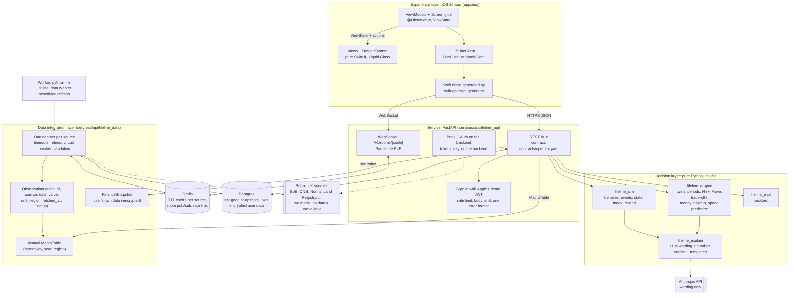

# Penny

_Your money, played forward._

**Penny. Your money, played forward. Many sources. One answer: your next money move. Play it before you live it.**

GUTS Hackathon 2026 (24 hours). BlackRock / Aladdin challenge: "One app. Every source. One clear decision."

- This README is the submission checklist. The sections follow the order of the official brief (ADR 0043).
- Code names keep the earlier working name "Lifeline": bundle ids, the Xcode project, `LifelineClient`, the Python packages `lifeline_*` (ADR 0040).

> **Not financial advice.** Penny is education. It shows how people like you did in similar past periods. It is not a forecast or a recommendation.

## 1. User story

**Yaffy**, **[age]**, **[student/working]** in **[city]**.

- He banks with Monzo.
- He holds a Stocks and Shares ISA at Trading212.
- He rents.
- His question: **"What is my next money move?"**
- Penny reads his money, adds live UK data, and gives him one move. He can play that move through a past shock before he makes it in real life.

The three bracketed values are placeholders. They stay visible until Yaffy confirms them (ADR 0043, "Open").

## 2. One decision: the Next Move

`GET /v1/next-move` returns one top move and up to two runners-up (ADR 0018). The engine (`lifeline_engine`) computes every number. No LLM chooses the move.

Each move has these parts (`services/api/lifeline_contracts/next_move.py`):

| Part | Field | What the user sees |
|---|---|---|
| Gain | `impact_per_year` (`gain_kind = gbp_per_year`) or `cover_months` (`gain_kind = months_of_cover`) | £ a year, or months of cover |
| Trade-off | `trade_off.summary`, `trade_off.points` (ADR 0042) | "What you give up: ..." on the card; all points in Why? |
| Worst case | `worst_case_per_year` | £ a year in the worst matched past period |
| Confidence | `confidence`, `confidence_label` | For example "7 in 10 twins in similar past periods did better" |
| Evidence | `evidence` (exactly 3 points, numbers in `facts`) | Three lines on the card, details in Why? |
| Decision sources | `decision_sources`, `decision_source_count` (ADR 0032) | Sources the engine read for this move, with status |

How the engine picks the move:

1. **Candidates.** The engine lists only moves that the data supports: fix or remortgage, move savings, cancel or switch a subscription, switch energy, pay off debt, build an emergency fund, cut a budget, spread investments. Spread investments needs ISA holdings; the API does not pass them yet (ADR 0042), so this move is inactive until Yaffy's Trading212 data lands.
2. **Score.** For each option, it simulates similar synthetic people ("twins") through matched past periods and one standard stress period per move kind. The option with the highest `expected - 0.5 x max regret` wins (ADR 0020).
3. **Rank.** Moves are ranked by `impact + 0.5 x min(0, worst case)`, scaled by confidence.
4. **Trade-off.** The engine writes the trade-off per move kind (`lifeline_engine/trade_offs.py`). No LLM writes it.
5. **Test it.** `POST /v1/next-move/test` plays the user's profile through the stress period once per option, on the same seed.
6. **Do this.** `POST /v1/plan` adds the move to the user's plan.

**The demo follows the engine's actual top move.** There is no planned headline. The presenter narrates what the API returns on the day (ADR 0020, ADR 0043).

Accuracy is reported as measured, including where the engine loses to a simple rule: [docs/prediction.md](docs/prediction.md) (ADR 0023).

## 3. Architecture diagram

Full description: [docs/architecture.md](docs/architecture.md).



## 4. Three layers

| Layer | Code | What it does |
|---|---|---|
| Experience | `apps/ios` | SwiftUI app for iOS 26. Tabs: Money (opens first, Next Move card on top), Life (the game), Play (Same Life rooms), You (profile, connections, "How Penny uses AI"). Talks only to our backend. Holds no keys. |
| Decision | `lifeline_engine`, `lifeline_sim`, `lifeline_eval`, `lifeline_explain` | `lifeline_engine` and `lifeline_sim` are pure: no network, no database, no clock, seeded RNG only. Same data plus same seed gives the same result. `lifeline_explain` rewords text and checks every number. |
| Data integration | `lifeline_data` | One adapter per source. Each value carries a status (`live`, `cached`, `unavailable`; `mock` only in demo mode). Redis TTL cache, Postgres last-good snapshot, annual `MacroTable`. |

A FastAPI service (`lifeline_api`) joins the layers. Errors use one format everywhere: `{"error": {"code": "...", "message": "...", "source": "..."}}`.

## 5. Data sources

Live list from `GET https://api-production-15615.up.railway.app/v1/sources`, fetched on 2026-10-17 at 17:58 UTC. 24 sources: 18 `live`, 6 `unavailable`. Status changes at run time; the endpoint is the source of truth.

Role: **Decision** = input to the Next Move (`DECISION_PROVIDERS` in `lifeline_engine/next_move.py`, plus the user's own data). **Context** = shown next to the decision, never an input (ADR 0030). **Game or support** = Life game events, region lookup, spend prediction or bank connection.

| id | Name | Status | Coverage | Licence | Role |
|---|---|---|---|---|---|
| `boe` | Bank of England Database | live | UK | Bank of England terms of use (free reuse with attribution) | Decision |
| `ons` | Office for National Statistics | live | UK | Open Government Licence v3.0 | Decision |
| `nomis` | Nomis (ONS labour market and Census) | live | UK; Census tables England and Wales | Open Government Licence v3.0 | Decision |
| `landregistry` | HM Land Registry UK House Price Index | live | UK | Open Government Licence v3.0 | Decision |
| `postcodes` | postcodes.io | live | UK | Open Government Licence v3.0 | Game or support |
| `bankholidays` | GOV.UK bank holidays | live | UK (England and Wales, Scotland, Northern Ireland) | Open Government Licence v3.0 | Game or support |
| `frankfurter` | Frankfurter FX rates | live | Global | Free to use (ECB reference rates) | Decision |
| `coingecko` | CoinGecko | live | Global | CoinGecko API terms (attribution required) | Decision |
| `yahoo` | Yahoo Finance chart endpoint | unavailable | Global | Yahoo terms of service; personal use | Game or support |
| `fred` | FRED, Federal Reserve Bank of St. Louis | unavailable | UK series (OECD) | FRED terms of use | Game or support |
| `octopus` | Octopus Energy products API | live | Great Britain | Octopus Energy API terms | Decision |
| `carbonintensity` | Carbon Intensity API | live | Great Britain | CC BY 4.0 | Game or support |
| `openmeteo` | Open-Meteo | live | Global | CC BY 4.0 | Game or support |
| `police` | Police UK data API | live | England, Wales and Northern Ireland | Open Government Licence v3.0 | Game or support |
| `environmentagency` | Environment Agency flood monitoring API | live | England | Open Government Licence v3.0 | Game or support |
| `companieshouse` | Companies House API | live | UK | Open Government Licence v3.0 | Decision |
| `adzuna` | Adzuna jobs API | unavailable | UK | Adzuna API terms | Game or support |
| `dvla` | DVLA Vehicle Enquiry Service | unavailable | Great Britain | Open Government Licence v3.0 | Game or support |
| `dvsamot` | DVSA MOT history API | unavailable | Great Britain | Open Government Licence v3.0 | Game or support |
| `statxplore` | DWP Stat-Xplore | live | Great Britain | Open Government Licence v3.0 | Game or support |
| `epc` | Energy Performance of Buildings register | live | England and Wales | Open Government Licence v3.0 | Game or support |
| `guardian` | The Guardian Open Platform | live | UK and world news | Guardian Open Platform terms (headlines and links only) | Context |
| `boe-mpc` | Bank of England MPC dates | live | UK | Bank of England terms of use (free reuse with attribution) | Context |
| `openbanking` | Open Banking sandbox (TrueLayer) | unavailable | UK | TrueLayer sandbox terms | Game or support (disabled, ADR 0027) |

Rules (ADR 0027, ADR 0032):

- **No mock data in live mode.** Railway and the iOS Demo configuration run with `DATA_MODE=live`. A source with no live or cached real data reports `unavailable`. Its values are absent from the `MacroTable`. Game events that need it do not fire.
- **Unavailable sources show "unavailable".** `/v1/sources` gives the status. The app shows "Unavailable".
- **Money data is the user's own.** In live mode, the fixture personas are not served. With no user data, `GET /v1/finance/home` returns `has_data: false` and a connect prompt.
- **"Based on N sources" counts decision sources only.** `decision_source_count` counts the decision sources that the engine read for this move. An unavailable source is listed but not counted. Game and context sources are never counted.
- **Local default is demo mode.** `make up` runs with `DATA_MODE=demo` unless `.env` sets `live`. Demo mode serves fixtures and labelled mock data (`status: "mock"`) for development and tests.
- Attribution text for each source: `attribution` in `/v1/sources` and [`services/api/lifeline_data_attributions.json`](services/api/lifeline_data_attributions.json).

## 6. API contract

- File: [`contracts/openapi.yaml`](contracts/openapi.yaml), versioned under `/v1`.
- It is generated from the Pydantic models in `services/api/lifeline_contracts/` (ADR 0002). Do not edit it by hand.
- Regenerate: `make contract`.
- The iOS client is generated from the same file by `swift-openapi-generator` (`make ios-gen` copies it into the app).
- Auth: `POST /v1/auth/demo` or `POST /v1/auth/apple` returns a JWT. Send it as `Authorization: Bearer ...`.

## 7. How to run

Prerequisites:

- Docker (Docker Desktop, or Colima with the compose plugin) and `make`.
- `uv` for local Python tests and lint.
- For iOS: Xcode with the iOS 26 SDK, and XcodeGen.
- No API keys are needed to start. A missing key makes that source `mock` (demo mode) or `unavailable` (live mode).

Backend, one command:

```bash
make up          # copies .env.example to .env if missing, builds, starts api + worker + postgres + redis, waits for /v1/health
```

- API: http://localhost:8000. Health: `GET /v1/health`.
- Stop: `make down`. All targets: `make help`.

iOS:

```bash
make ios-gen     # copies the contract into the app and generates Lifeline.xcodeproj
```

- Open `apps/ios/Lifeline.xcodeproj`.
- Schemes:
  - `Lifeline`: the app (Debug config, local API at `http://localhost:8000`), plus unit and UI tests.
  - `Playground`: `Mock` config with `-playground`. A gallery of every screen on `MockClient`. No backend.
- Configurations:
  - `Mock`: `MockClient`, recorded responses, no backend.
  - `Demo`: `LiveClient` against Railway.
  - Also `Debug`, `Dev` and `Release`.
- Phone build: `make ios-device CONFIG=Mock` or `CONFIG=Demo` (needs `apps/ios/Config/Local.xcconfig` with your team, ADR 0015).

Hosted API (Railway, `DATA_MODE=live`, ADR 0028): https://api-production-15615.up.railway.app

## 8. Tests

| Suite | Path | Command |
|---|---|---|
| Unit (Python) | `services/api/tests/unit/{api,data,engine,eval,explain,sim}` | `make test` (runs `uv run pytest` in `services/api`) |
| Integration (Python, HTTP and WebSocket) | `services/api/tests/integration` | `make test` |
| Contract (responses against `openapi.yaml`, incl. `test_next_move_trade_offs`) | `services/api/tests/contract` | `make test`; against the running stack: `make test-stack` |
| Lint and types | ruff, `mypy --strict`, AI disclosure copy in sync | `make lint` |
| iOS unit and UI | `apps/ios/LifelineTests`, `apps/ios/LifelineUITests` | `make ios-test` |
| Secrets | gitleaks over the working tree | `make secrets-scan` |

- Python tests never call the network. They use recorded fixtures under `services/api/tests/fixtures/`.
- Verifiers V1 to V6 are separate agents that check the work and write reports to [docs/verify/](docs/verify/):
  - V1 contract, V2 engine, V3 resilience, V4 iOS, V5 demo, V6 security.

## 9. Graceful failure

| Failure | What happens | Where |
|---|---|---|
| A source is down or has no key | Cached real data if present, else `unavailable`. Never mock in live mode. The decision lists the source but does not count it. | `lifeline_data`, ADR 0027, ADR 0032 |
| LLM missing, slow or wrong | Template text from the engine. A number that fails the verifier is never shown. | `lifeline_explain`, ADR 0019 |
| Ask Penny answer fails the number check | One rewrite. Then a summary of the tool facts, marked as not checked. | `lifeline_explain/chat.py` |
| Rate limit (429) | The app retries quietly with backoff and honours `Retry-After`. Then it shows "Couldn't load. Pull to refresh." | `apps/ios/Lifeline/Networking/ResilienceMiddleware.swift`, ADR 0038 |
| No money data yet | Not an error. `GET /v1/finance/home` returns `has_data: false`. Money home shows one card: "Connect your money to see your next move". | `lifeline_api/routes/finance.py`, ADR 0038 |
| Any API error | One format: `{"error": {"code", "message", "source"}}`. "Try again" shows only for real network or server errors. | `lifeline_api`, ADR 0038 |

## 10. Security and secrets

- **Keys live only in `.env`** (git-ignored) and in Railway variables. `.env.example` lists every variable name. The app holds no keys.
- **gitleaks before every commit.** BOSS runs `make secrets-scan` before each commit. A finding blocks the commit (ADR 0041).
- **User bank data is encrypted in Postgres.** `UserSnapshotStore` stores each user's `FinanceSnapshot` as Fernet ciphertext with `TOKEN_ENCRYPTION_KEY` (`lifeline_data/crypto.py`, `lifeline_data/cache.py`). In live mode or `APP_ENV=prod`, a missing key stops the store; nothing is stored as plain text.
- **Bank tokens stay on the backend.** OAuth runs on the server. Tokens never reach the device. Rule: tokens are stored encrypted in Postgres with the same `Sealer` (ADR 0028). See section 13 for the open item.
- **Untrusted text is fenced.** News headlines, chat messages, merchant names and statement text go to the model inside `<untrusted source="...">` blocks. The system prompt says that this text is data, never instructions (ADR 0034, `lifeline_explain/chat.py`, `lifeline_explain/prompts.py`).
- Bearer tokens are removed from logs (`lifeline_api/logsafe.py`). Per-user rate limits apply to reads, writes and chat.
- Security report: [docs/verify/V6.md](docs/verify/V6.md).

## 11. AI disclosure: How Penny uses AI

Source: [`services/api/lifeline_explain/ai_disclosure.json`](services/api/lifeline_explain/ai_disclosure.json). The You tab shows the same text. `make lint` fails if the app copy differs.

**Where AI is used**

- An AI model (Claude, from Anthropic) rewords the text of game events and their outcomes.
- It rewords the headline and the evidence lines on the Next Move card.
- It writes the wording of Ask Penny answers. Penny gets every number from the engine's tools.
- Lessons are fixed text. AI does not write them.
- The app never calls the AI model. Only our server calls it.

**What stays deterministic**

- Every number comes from your data, a public data source or the engine. AI never makes a number.
- The engine ranks the moves and picks your Next Move. AI does not choose it.
- The engine writes the trade-off of each move (What you give up). Penny can only say it in other words.
- The game engine decides every event, outcome and money change. The same seed gives the same game.

**How output is checked**

- A number verifier checks every number in AI text against the engine's facts. It also checks the unit: a money fact needs a £ sign and a percent fact needs a % sign. Code: services/api/lifeline_explain/verifier.py.
- Verifier tests: services/api/tests/unit/explain/test_explain.py and services/api/tests/unit/explain/test_trade_off.py.
- Golden tests ask Penny 30 fixed questions with a fake AI model and check each answer: services/api/tests/unit/explain/test_chat.py.
- Prompt injection tests put hostile text in news headlines, merchant names and user messages. The model gets this text fenced as data. The tests check that it cannot change a rule or add a number. Same file: test_chat.py.

**What happens when AI fails**

- No AI key, an AI error or a failed check: events, outcomes and the Next Move card show the engine's template text. The template text is complete and correct.
- If an Ask Penny answer fails the number check, Penny gets one rewrite. If it fails again, Penny shows a summary of the tool facts, marked as not checked.
- If the AI model is off, Penny shows the facts of your Next Move.
- By default, each AI call stops after 12 seconds and an Ask Penny answer stops after 24 seconds. Then the fallback text shows.
- A number that fails the check is never shown.

How we used AI to build Penny (Claude Code agents, verifiers, gates): [docs/AI_USAGE.md](docs/AI_USAGE.md). Product rules: [docs/RESPONSIBLE_AI.md](docs/RESPONSIBLE_AI.md).

## 12. Trade-offs and decisions

Every decision is an Architecture Decision Record (ADR) in [docs/adr/](docs/adr/).

| ADR | Decision |
|---|---|
| [0001](docs/adr/0001-record-decisions.md) | Record decisions as ADRs |
| [0002](docs/adr/0002-contract-generated-from-pydantic.md) | Generate `openapi.yaml` from shared Pydantic models |
| [0003](docs/adr/0003-spec-file-name-and-existing-repo.md) | Spec file name and the existing team repo |
| [0004](docs/adr/0004-ownership-of-shared-build-files.md) | Who owns Makefile, docker-compose and Dockerfile |
| [0005](docs/adr/0005-pure-core-macro-table.md) | Engine and sim consume an annual MacroTable |
| [0006](docs/adr/0006-local-tooling.md) | Local toolchain |
| [0007](docs/adr/0007-llm-model-opus.md) | LLM model for flavour text |
| [0008](docs/adr/0008-engine-conventions.md) | Engine conventions |
| [0009](docs/adr/0009-ios-tab-layout.md) | iOS tab layout and client conventions |
| [0010](docs/adr/0010-data-fallback-and-mapping.md) | Data fallback order and series mapping |
| [0011](docs/adr/0011-ios-view-viewmodel-split.md) | iOS split into pure Views and ViewModels |
| [0012](docs/adr/0012-sim-replay-and-index.md) | Sim replay model and Index edge cases |
| [0013](docs/adr/0013-index-relative-penalties.md) | Index penalties relative to the autopilot twin |
| [0014](docs/adr/0014-year-end-values-for-fast-series.md) | Year-end values for fast-moving series |
| [0015](docs/adr/0015-device-signing-local-xcconfig.md) | Device signing through a git-ignored `Local.xcconfig` |
| [0016](docs/adr/0016-app-tabs-and-money-tab.md) | App tabs (Money, Life, Play, You) and the Money tab |
| [0017](docs/adr/0017-spend-prediction-and-guess-my-spend.md) | Daily spend prediction and "Guess my spend" |
| [0018](docs/adr/0018-next-move.md) | One question: "What is my next money move?" |
| [0019](docs/adr/0019-explain-layer.md) | Explain layer: LLM wording, number verifier, templates |
| [0020](docs/adr/0020-stress-period-in-risk.md) | Stress period in Next Move risk; the demo follows the engine |
| [0021](docs/adr/0021-data-tier1.md) | Tier 1 data choices |
| [0022](docs/adr/0022-api-tier1.md) | Tier 1 API choices |
| [0023](docs/adr/0023-confidence-and-honest-accuracy.md) | Confidence for multi-option moves; honest accuracy reporting |
| [0024](docs/adr/0024-sim-tier1.md) | Tier 1 sim choices |
| [0025](docs/adr/0025-ios-tier1.md) | Tier 1 iOS structure |
| [0026](docs/adr/0026-native-design-rebuild.md) | Native SwiftUI rebuild of the design handoff |
| [0027](docs/adr/0027-no-mock-in-live.md) | No mock data in live mode; disabled sources |
| [0028](docs/adr/0028-railway-deploy.md) | Railway deployment |
| [0029](docs/adr/0029-tier2-away-plan.md) | Tier 2 scope |
| [0030](docs/adr/0030-news-and-rate-dates.md) | News and rate-decision dates are context only |
| [0031](docs/adr/0031-ask-penny.md) | Ask Penny answers only through engine tools |
| [0032](docs/adr/0032-decision-sources-count.md) | "Based on N sources" counts decision sources only |
| [0033](docs/adr/0033-chat-tools-and-facts-table.md) | Engine tools for Penny, cash-flow projection, facts table |
| [0034](docs/adr/0034-untrusted-text.md) | Untrusted text is data, never instructions |
| [0035](docs/adr/0035-parallel-backend-tier2.md) | Tier 2 backend in parallel with the Tier 1 iOS gate |
| [0036](docs/adr/0036-yaffy-merge.md) | Merge of Yaffy's integration branch |
| [0037](docs/adr/0037-parallel-ios-features.md) | Parallel iOS feature work |
| [0038](docs/adr/0038-money-empty-state-and-limits.md) | No-data is a normal state; one Money home request; quiet rate limits |
| [0039](docs/adr/0039-phone-milestones.md) | Phone installs at milestones only |
| [0040](docs/adr/0040-product-name-penny.md) | Product name "Penny" |
| [0041](docs/adr/0041-boss-commits.md) | BOSS commits on main |
| [0042](docs/adr/0042-trade-offs.md) | Every Next Move states its trade-off |
| [0043](docs/adr/0043-official-brief-alignment.md) | Official GUTS brief alignment |
| [0044](docs/adr/0044-same-life-room-rules.md) | Same Life room rules |

## 13. Official checklist

| | Brief requirement | Evidence |
|---|---|---|
| [ ] | Named user | Section 1, [docs/DEMO.md](docs/DEMO.md). **Missing:** Yaffy's age, situation and city (placeholders), and his consent to show his data on stage (ADR 0043). |
| [x] | One clear decision | Section 2. `GET /v1/next-move`, `lifeline_engine/next_move.py`, ADR 0018 |
| [x] | Evidence | 3 evidence points with facts, confidence, worst case, decision sources. `lifeline_contracts/next_move.py`, [docs/prediction.md](docs/prediction.md) |
| [x] | Trade-offs | "What you give up" on every move. `lifeline_engine/trade_offs.py`, `test_next_move_trade_offs`, ADR 0042 |
| [ ] | Multiple data sources | Section 5: 18 live public sources, 8 of them decision inputs. **Missing:** Yaffy's real Monzo and Trading212 data. It lives on branch `merge/yaffy` and is not on `main` yet (ADR 0036). |
| [x] | Meaningful version control | Section "Version control" below, [docs/COMMITS.md](docs/COMMITS.md), ADR 0041 |
| [x] | AI disclosure | Section 11, `ai_disclosure.json`, You tab, [docs/RESPONSIBLE_AI.md](docs/RESPONSIBLE_AI.md), [docs/AI_USAGE.md](docs/AI_USAGE.md) |
| [x] | How to run | Section 7, `Makefile` |
| [x] | Tests | Section 8, `services/api/tests/`, `apps/ios/LifelineTests/`, [docs/verify/](docs/verify/) |
| [ ] | Security | Section 10, [docs/verify/V6.md](docs/verify/V6.md). **Missing:** bank tokens encrypted in Postgres. On `main` no token store exists yet. On `merge/yaffy`, Monzo and Trading212 tokens are plain files under `CREDENTIALS_DIR`; the move to Postgres with `Sealer` is open (ADR 0036, follow-ups). |

## Version control

- `c983e86`: the team's first plan (README and `docs/PLAN.md`).
- `63e8f1a` to `e58e8f3`: the agent-built foundation, one commit per layer (rules, contract, data, engine, sim, explain, API, iOS, Tier 0 sign-off).
- `d4f0aa2` and `cb6f847` are combined on purpose: their features share contract models and app wiring, and split commits would not pass the tests. Each message lists the features and their ADRs.
- One logical change per commit, Conventional Commits style, tests passing on each commit, `make secrets-scan` before each commit (ADR 0041). Messages are also in [docs/COMMITS.md](docs/COMMITS.md).
- Decisions are in [docs/adr/](docs/adr/).

## Team

| Name | Area |
|---|---|
| Yath | "Play yourself" layer: adapters, habit vector, backtest, scenarios, dashboard, friends |
| Ash | Historical engine: synthetic population, twin matching, past-period replay, life loop |
| TBC | TBC |
| TBC | TBC |
| TBC | TBC |
