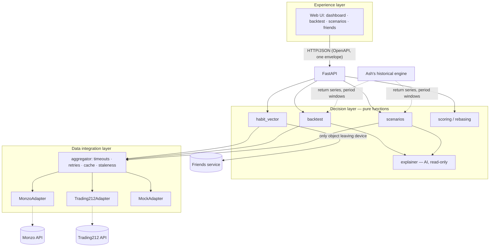

# One app. Every source. One clear decision.

GUTS Hackathon 2026 (Glasgow, 17–18 Oct) · BlackRock / Aladdin challenge · team of 5

A UK personal-finance app. It pulls your own accounts into one view. Then it lets you **play yourself**: replay your real saving and investing habits through past market shocks, and compare modelled paths forward.

> **Status: early build.** This README describes what we're building. Anything marked *(planned)* doesn't exist yet. See [docs/PLAN.md](docs/PLAN.md) for the build order and open questions.

> **Not financial advice.** Every forward-looking output is a *modelled scenario based on similar past periods*. None of it is a forecast or a recommendation.

---

## What it does

| Area | Description | Owner |
|---|---|---|
| Dashboard | Bank balance, spending and ISA holdings in one view | Yath |
| Backtest | Run your real contribution habits through 2008, COVID and 2022 with different allocation splits (DCA vs lump sum, rebalancing rules) | Yath |
| Future insight | A fan of outcomes from past periods with similar starting conditions | Yath |
| Friends | Compete on scores and values rebased to 100. Opt-in pie of your invested-assets split. Never £ amounts | Yath |
| Historical engine | Synthetic UK population, twin matching, past-period replay, gamified life loop | Ash |

## Data sources

All sources are the user's own accounts, accessed **read-only**:

- **Monzo API**: balances, pots and transactions (OAuth 2.0 or playground token)
- **Trading212 API**: Stocks & Shares ISA holdings and cash

Each source sits behind a `FinanceAdapter`. A `MockAdapter` implements the same interface with deterministic personas, so the app runs fully offline. Mock mode is the default.

## Privacy model

- Raw transactions, balances and holdings **stay on the device**.
- `habit_vector()` is the only thing that leaves it. It holds ratios and 0–100 scores, never £ amounts:
  - savings rate
  - runway (months)
  - spend stability
  - discretionary share
  - subscription creep
  - ISA diversification (HHI)
  - shock resilience
- The friends feature only shows values rebased to 100. Sharing your allocation pie (percentages only) is opt-in.

## Architecture



### Trade-offs (draft)

| Decision | Why | Cost |
|---|---|---|
| One adapter interface with capability flags, rather than one interface per source type | The mock can stand in for any source, and the aggregator stays simple | Some methods raise `UnsupportedCapability` on some adapters |
| Money stored as integer pence | No float rounding errors in sums or caps | Values are converted at the edges for display |
| Decision layer is pure, with no I/O | Fast deterministic tests. Easy to reason about | The aggregator has to fetch everything up front |
| Partial results plus a stale cache instead of hard failure | The demo survives a slow or failing API | The UI has to show which sources are stale |
| Time-weighted return index rebased to 100 for comparisons | People with different incomes can be compared fairly and privately | Hides absolute outcomes, which stay local only |
| Synthetic returns first, real series later | Unblocks the backtest immediately | Early results are illustrative only |
| AI explains results but never decides | Numbers stay auditable. No hallucinated figures | Explanations are less flexible. Template fallback when offline |

## API conventions *(planned)*

- Versioned under `/v1`. The spec is served at `/openapi.json` and exported to `docs/openapi.json`.
- Every response, including errors, uses one envelope:

```json
{ "data": { }, "error": null, "meta": { "request_id": "…", "as_of": "…", "stale": false, "sources": { } } }
```

```json
{ "data": null, "error": { "code": "source_timeout", "message": "…", "details": { } }, "meta": { } }
```

## Quick start *(planned)*

```bash
cp .env.example .env   # mock mode by default, no credentials needed
make run               # installs deps and starts the API + UI on mock data
make test              # unit + integration tests
make lint              # ruff lint + format check
```

## Configuration

All configuration comes from environment variables. No secrets are stored in code. `.env` is gitignored, and `.env.example` lists every variable *(planned)*.

| Variable | Purpose |
|---|---|
| `MONZO_MODE` / `T212_MODE` | `mock` (default) or `live`, set per source |
| `MONZO_ACCESS_TOKEN` | Monzo token (live mode only) |
| `T212_API_KEY` | Trading212 API key (live mode only) |
| `SOURCE_TIMEOUT_SECONDS` | Timeout for each source fetch |
| `ISA_ALLOWANCE_PENCE` | Annual ISA allowance used by the backtest |

## Testing

- **Unit tests**:
  - each `habit_vector` factor, with hand-computed fixtures
  - backtest maths (closed-form checks, ISA cap)
  - scoring and rebasing
  - the response envelope
- **Contract tests**: every adapter satisfies `FinanceAdapter`.
- **Integration test**: API → aggregator → mock adapters, end to end.
- **Privacy test**: `habit_vector` output contains no monetary values.

## Project layout *(planned)*

```
src/playyourself/   adapters/ · domain/ · decision/ · api/ · settings.py
data/mock/          personas and synthetic return series (clearly labelled)
tests/              unit/ · integration/
docs/               PLAN.md · architecture.md · openapi.json
```

## AI use (declaration)

- **In the product**: an LLM turns the engine's structured results into plain-English explanations. It never computes or changes figures, and its output is checked against the input numbers. A template fallback runs when no API key is set.
- **In development**: we used Claude Code to help with planning, scaffolding, documentation and code. A team member reviews all generated code.

## Team

| Name | Area |
|---|---|
| Yath | "Play yourself" layer: adapters, habit vector, backtest, scenarios, dashboard, friends |
| Ash | Historical engine: synthetic population, twin matching, past-period replay, life loop |
| TBC | TBC |
| TBC | TBC |
| TBC | TBC |
