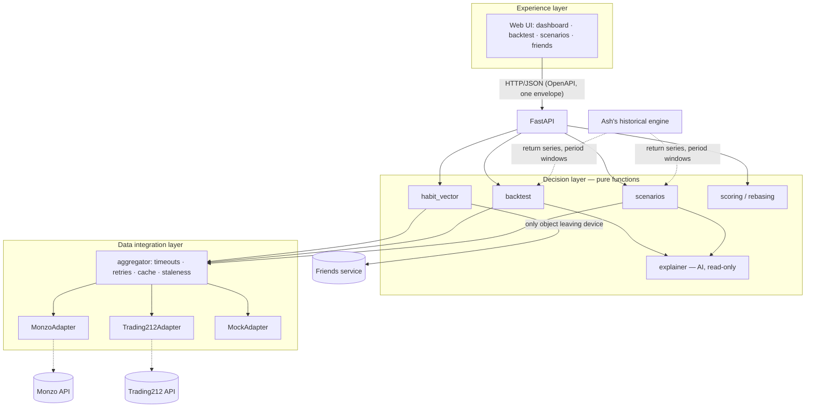

# One app. Every source. One clear decision.

GUTS Hackathon 2026 (Glasgow, 17–18 Oct) · BlackRock / Aladdin challenge · team of 5

A UK personal-finance app. It pulls your own accounts into one view. Then it lets you **play yourself**: replay your real saving and investing habits through past market shocks, and compare modelled paths forward.

> **Status:** the core works end-to-end on mock data (API, dashboard, habit vector, backtest, scenarios, friends, web UI). The live Trading212 and Monzo adapters are checked against the official docs but not yet tested against real accounts. The few unconfirmed details are marked `VERIFY` in the code. See [docs/PLAN.md](docs/PLAN.md) for the build order and open questions, and [docs/architecture.md](docs/architecture.md) for the design.

> **Not financial advice.** Every forward-looking output is a *modelled scenario based on similar past periods*. None of it is a forecast or a recommendation.

---

## What it does

| Area | Description | Owner |
|---|---|---|
| Dashboard | Bank balance, spending and ISA holdings in one view | Yath |
| Spending | Monthly income vs spend, categories with change vs the previous period, top merchants, subscriptions, unusual transactions and weekday patterns. Local only | Yath |
| Connections | Connect your own Monzo and Trading212 accounts from the UI, or stay on demo data. Credentials stay on this machine | Yath |
| Backtest | Run your real contribution habits through 2008, COVID and 2022 with different allocation splits (DCA vs lump sum, rebalancing rules) | Yath |
| Future insight | A fan of outcomes from past periods with similar starting conditions | Yath |
| Friends | Compete on scores and values rebased to 100. Opt-in pie of your invested-assets split. Never £ amounts | Yath |
| Historical engine | Synthetic UK population, twin matching, past-period replay, gamified life loop | Ash |

## Data sources

All sources are the user's own accounts, accessed **read-only**:

- **Monzo API**: balances, pots and transactions (OAuth 2.0 or playground token)
- **Trading212 API**: Stocks & Shares ISA holdings and cash

Each source sits behind a `FinanceAdapter`. A `MockAdapter` implements the same interface with deterministic personas, so the app runs fully offline. Mock mode is the default, and you can connect live accounts from the UI.

## Privacy model

- Raw transactions, balances and holdings **stay on the device**.
- `habit_vector()` is the only thing that leaves it. It holds ratios and 0–100 scores, never £ amounts:
  - savings rate
  - runway (months)
  - spend stability
  - discretionary share
  - subscription creep
  - ISA diversification (HHI)
  - shock resilience
- The friends feature only shows values rebased to 100. Sharing your allocation pie (percentages only) is opt-in.

## Architecture



### Trade-offs (draft)

| Decision | Why | Cost |
|---|---|---|
| One adapter interface with capability flags, rather than one interface per source type | The mock can stand in for any source, and the aggregator stays simple | Some methods raise `UnsupportedCapability` on some adapters |
| Money stored as integer pence | No float rounding errors in sums or caps | Values are converted at the edges for display |
| Decision layer is pure, with no I/O | Fast deterministic tests. Easy to reason about | The aggregator has to fetch everything up front |
| Partial results plus a stale cache instead of hard failure | The demo survives a slow or failing API | The UI has to show which sources are stale |
| Time-weighted return index rebased to 100 for comparisons | People with different incomes can be compared fairly and privately | Hides absolute outcomes, which stay local only |
| Synthetic returns first, real series later | Unblocks the backtest immediately | Early results are illustrative only |
| AI explains results but never decides | Numbers stay auditable. No hallucinated figures | Explanations are less flexible. Template fallback when offline |

## API conventions

- Versioned under `/v1`. The spec is served at `/openapi.json` and exported to `docs/openapi.json` (`make openapi`).
- Endpoints:

| Method | Path | Purpose |
|---|---|---|
| GET | `/v1/health` | Per-source health and mock/live mode |
| GET | `/v1/dashboard` | Balances, ISA value, allocation, spend by category, recent transactions (local UI only) |
| GET | `/v1/habit-vector` | The 7 habit factors plus overall score |
| GET | `/v1/spending?months=6` | Spending analysis for 1 to 12 months (pence, local UI only) |
| GET | `/v1/connect/status` | Per source: demo or live, masked credential hint, health |
| POST | `/v1/connect/monzo/token` | Paste a Monzo playground token (validated before it is stored) |
| POST | `/v1/connect/trading212` | Paste a Trading212 API key and secret |
| DELETE | `/v1/connect/{source}` | Forget credentials and go back to demo data |
| GET | `/v1/connect/monzo/start` | Start Monzo OAuth (redirects to Monzo) |
| GET | `/v1/connect/monzo/callback` | OAuth redirect target, then back to the UI |
| POST | `/v1/backtest` | Replay your habits under one or more strategies |
| POST | `/v1/scenarios` | Modelled scenarios from similar past periods |
| POST | `/v1/explain` | Plain-English explanation of a result (AI or template) |
| GET | `/v1/periods` | Available replay periods and assets |
| GET | `/v1/friends/leaderboard` | You and your friends, ranked by habit score |
| PUT | `/v1/friends/share` | Opt in or out of sharing your allocation pie |
| GET | `/v1/friends/me/card` | Exactly what leaves your device |

- Every response, including errors, carries an `X-Request-ID` header that matches `meta.request_id`.
- Every response, including errors, uses one envelope:

```json
{ "data": { }, "error": null, "meta": { "request_id": "…", "as_of": "…", "stale": false, "sources": { } } }
```

```json
{ "data": null, "error": { "code": "source_timeout", "message": "…", "details": { } }, "meta": { } }
```

## Quick start

```bash
cp .env.example .env   # mock mode by default, no credentials needed
make run               # installs deps and serves the API + UI at http://localhost:8000
make test              # unit + integration tests
make lint              # ruff lint + format check
make openapi           # export docs/openapi.json
```

## Connecting real accounts

Open the **Connections** tab. Each source shows **Demo data** or **Live**. Everything is read-only.

- **Monzo, OAuth**: set `MONZO_CLIENT_ID` and `MONZO_CLIENT_SECRET`, and register the redirect URI (`MONZO_REDIRECT_URI`, default `http://localhost:8000/v1/connect/monzo/callback`) in the Monzo developer portal. Then press "Connect with Monzo". Without a client ID the button is disabled.
- Monzo needs a **Confidential** OAuth client to issue refresh tokens, and you must approve access in the Monzo app (push notification) after authorising, or calls fail.
- **History import**: in the first 5 minutes after you authorise, the app imports your full Monzo history (after that Monzo only shares 90 days). It is stored locally in `data/private/monzo_history.json` (mode 0600, gitignored) and deleted on disconnect.
- **Monzo, playground token**: paste an access token into the form.
- **Trading212**: generate an API key in the Trading212 app (it comes as a key and a secret) and paste both. The API works for Invest and Stocks ISA accounts only. There is no OAuth option: the docs only describe key + secret.
- Credentials are checked against the provider before they are stored. A rejected key is reported and nothing is saved.
- "Remember on this device" is on by default and writes credentials to `data/private/credentials.json` (mode 0600, gitignored; change the folder with `CREDENTIALS_DIR`), so a server restart doesn't log you out. Untick it to keep them in memory only. Disconnect deletes them from memory and disk.
- Secrets are never logged and never returned by the API, only a masked hint such as `…a1b2`.
- Env vars (`MONZO_ACCESS_TOKEN`, `T212_API_KEY`, `T212_API_SECRET`) still work as a fallback when nothing is stored.
- The server binds to localhost only. State-changing routes require a JSON body and reject foreign `Origin` headers.
- Monzo endpoints, auth and request parameters are checked against docs.monzo.com; remaining unconfirmed details are marked `VERIFY` in the code. Trading212 auth, endpoints and fields are checked against docs.trading212.com. The only limits the app applies are the documented ones (Monzo: 100 transactions per page, full history only in the first 5 minutes; Trading212: positions once per second, account summary once per 5 seconds).

## Configuration

All configuration comes from environment variables. No secrets are stored in code. `.env` is gitignored, and `.env.example` lists every variable.

| Variable | Purpose |
|---|---|
| `MONZO_MODE` / `T212_MODE` | `mock` (default) or `live`, set per source |
| `MONZO_ACCESS_TOKEN` | Monzo token (live mode only) |
| `T212_API_KEY` | Trading212 API key (live mode only) |
| `SOURCE_TIMEOUT_SECONDS` | Timeout for each source fetch |
| `SOURCE_MAX_RETRIES` | Retries for retryable source errors |
| `ISA_ALLOWANCE_PENCE` | Annual ISA allowance used by the backtest |
| `MOCK_PERSONA` | Mock persona for your own data (default `steady_saver`) |
| `ANTHROPIC_API_KEY` / `EXPLAINER_MODEL` | Optional. Without a key, explanations use a template |
| `T212_API_SECRET` | Optional Trading212 API secret (Basic auth) |
| `MONZO_CLIENT_ID` / `MONZO_CLIENT_SECRET` | Monzo OAuth client from the developer portal |
| `MONZO_REDIRECT_URI` / `MONZO_AUTH_URL` / `MONZO_TOKEN_URL` | OAuth redirect and endpoints (URLs unverified) |
| `CREDENTIALS_DIR` | Where remembered credentials are saved (default `data/private`) |
| `CACHE_DIR` | Stale-data cache and friends preferences (default `data/cache`) |

## Testing

- **Unit tests**:
  - each `habit_vector` factor, with hand-computed fixtures
  - backtest maths (closed-form checks, ISA cap)
  - scoring and rebasing
  - the response envelope
- **Contract tests**: every adapter satisfies `FinanceAdapter`.
- **Integration test**: API → aggregator → mock adapters, end to end.
- **Privacy test**: `habit_vector` output contains no monetary values.

## Project layout

```
src/playyourself/   adapters/ · domain/ · decision/ · api/ (app, envelope, routes/) · static/ (web UI) · settings.py
data/mock/          personas and synthetic return series (clearly labelled)
tests/              unit/ · integration/
docs/               PLAN.md · architecture.md · openapi.json
```

## AI use (declaration)

- **In the product**: an LLM turns the engine's structured results into plain-English explanations. It never computes or changes figures, and its output is checked against the input numbers. A template fallback runs when no API key is set.
- **In development**: we used Claude Code to help with planning, scaffolding, documentation and code. A team member reviews all generated code.

## Team

| Name | Area |
|---|---|
| Yath | "Play yourself" layer: adapters, habit vector, backtest, scenarios, dashboard, friends |
| Ash | Historical engine: synthetic population, twin matching, past-period replay, life loop |
| TBC | TBC |
| TBC | TBC |
| TBC | TBC |
