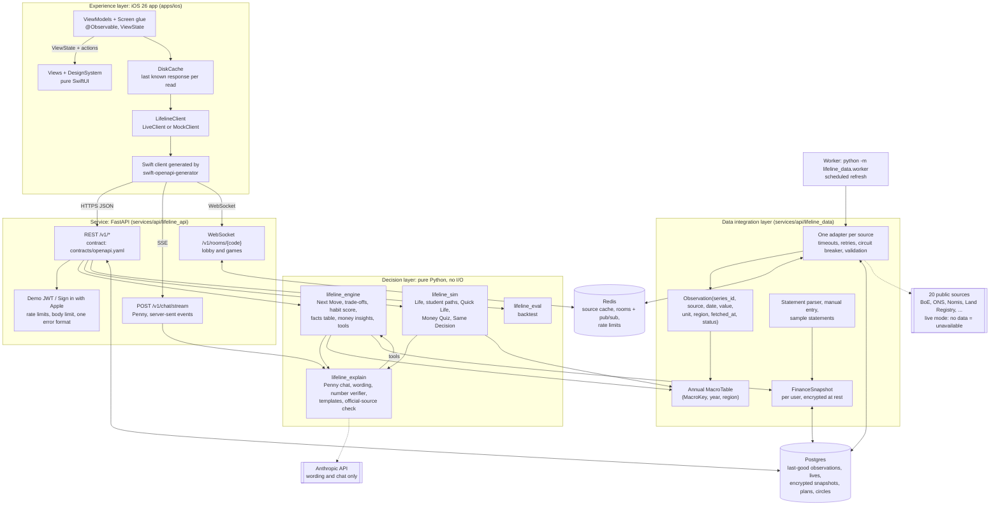
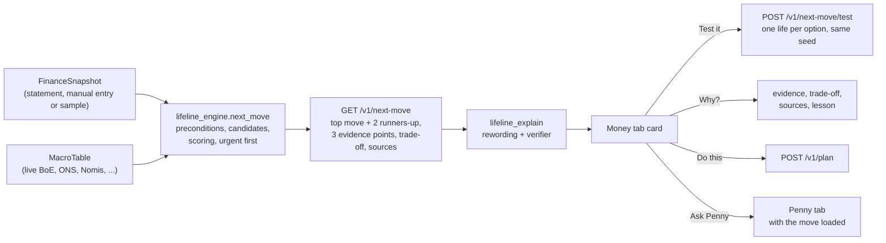
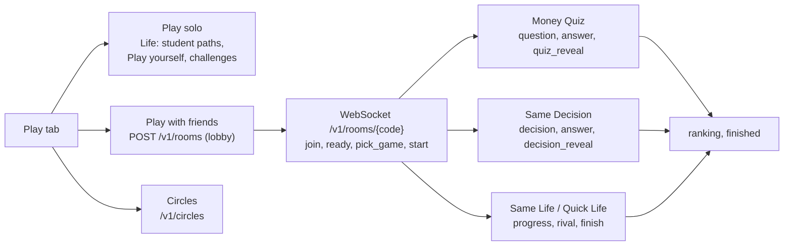

# Architecture

Penny has three layers, as the brief requires: experience, decision and data integration. A FastAPI service joins them. This page describes the Direction V2 design (`DIRECTION_V2.md`, ADRs 0046 to 0061) and the code paths that implement it.

## System diagram

## Layers

### Experience: `apps/ios`

- SwiftUI app for iOS 26. Compact layout: small tab icons and labels, small titles, little top padding (ADR 0048).
- Four tabs (ADR 0048, `App/RootScreen.swift`):

| Tab | What it holds |
|---|---|
| Money (opens first) | Next Move card (move, gain, trade-off, confidence with sample size, "Based on N sources", Test it, Why?, Do this, Ask Penny), balance and net worth tiles, Guess my spend, Coming up, See all (ADR 0050) |
| Penny | Full-screen chat with two answer modes. "Ask Penny" buttons elsewhere switch to this tab with context loaded (ADR 0051) |
| Play | "Play solo" (Life) and "Play with friends" (lobby, games), Circles, challenges (ADR 0052) |
| You | Profile, data inputs, "How Penny uses AI", judge mode ("New player", "Reset demo"), account (ADR 0049) |

- Onboarding (ADR 0049): welcome (3 pages), sign in, "Connect your money" (Use a sample statement, Upload a statement, Enter your numbers), import progress, Next Move reveal, tips.
- Instant screens (ADR 0060): `Networking/DiskCache.swift` keeps the last known response for each read and shows it at once; a background refresh replaces it. Profile, Money home and lists load at launch. Fixed content (paths, sample students, lessons, concepts) ships in the bundle. Loading states show skeletons, never spinners with text.
- XcodeGen builds the project from `apps/ios/project.yml`. `swift-openapi-generator` builds the network client from `contracts/openapi.yaml`.
- The app talks only to our backend. It holds no keys.
- Networking sits behind `protocol LifelineClient` (ADR 0011):
  - `LiveClient` wraps the generated OpenAPI client. `ChatStream.swift` reads Penny's server-sent events. `RoomSocket.swift` runs the room WebSocket.
  - `MockClient` returns recorded responses with no backend.
  - Selection: launch argument `-mockClient`, else the build setting `LIFELINE_CLIENT` (`mock` in the `Mock` configuration, `live` in the others).
- Configurations: `Debug` (local API), `Mock` (no backend), `Demo` and `Dev` (Railway), `Release`.
- Each screen has three parts (ADR 0011): an `@Observable` ViewModel that exposes a plain ViewState, a pure View, and `<Screen>Screen.swift` glue.
- The `Playground` scheme runs the `Mock` configuration with `-playground`. It opens a gallery of every screen and fixture state.

### Decision: `lifeline_engine`, `lifeline_sim`, `lifeline_eval`, `lifeline_explain`

- `lifeline_engine` and `lifeline_sim` are pure. They do no network, database or clock calls. They take a seeded RNG as an argument.
- Same `MacroTable` plus same seed gives the same life (ADR 0005).
- `lifeline_engine.next_move`: candidates, preconditions, scoring and ranking. See "Next Move flow".
- `lifeline_engine.trade_offs`: the trade-off text per move kind (ADR 0042). Every number in it is a fact.
- `lifeline_engine.student`: income schedules (maintenance loan instalments, termly bursary, weekly pay), the next money date, expensive debt rules.
- `lifeline_engine.habits`: the habit score. Six ratios from 0 to 100 (savings rate, months of cover, spend stability, discretionary share, subscription creep, debt pressure) and an overall score. No amounts (ADR 0052).
- `lifeline_engine.rules`: the facts table. 55 official rule facts for 2026/27, each with its official URL and checked date (ADR 0058).
- `lifeline_engine.tools`: the engine functions that Penny calls (`{result, facts, sources}`, ADR 0033).
- `lifeline_engine.money`: Money tab insights and the daily spend prediction (ADR 0016, 0017).
- `lifeline_sim`: the Life game. Student paths (`paths.py`: uni, apprentice, job18, gap_year, masters) with official tuition fee caps and Master's Loan amounts; Quick Life (`quick.py`); Money Quiz questions (`quiz.py`, 59 questions from the facts table and lessons); Same Decision prompts (`decisions.py`, 14 prompts from 2007 to 2023) (ADR 0061).
- `lifeline_eval`: backtests for [docs/prediction.md](prediction.md).

### Explain layer: `lifeline_explain`

Engine text (ADR 0019):

1. The engine or sim produces a template text plus `facts` (the numbers behind it).
2. The model (`LLM_MODEL`, default `claude-opus-5-5`) may reword event text, outcome text and the Next Move headline, action and evidence. Numbers, options, sources and confidence never pass through it.
3. The verifier extracts every number from the model text. Each must match an allowed value at the written precision, or within 0.5%, with the right unit (£ or %).
4. Any unmatched number rejects the text. The template text is used.
5. One call, no retry, hard timeout (`LLM_TIMEOUT_SECONDS`, default 12 s). Results are cached in Redis and verified again on every cache hit. `LLM_ENABLED=0` forces templates.

Penny chat (ADR 0051, 0058, 0060):

1. `POST /v1/chat/stream` sends a `reaction` event within 1 s.
2. The chat model (`CHAT_MODEL`, default `claude-sonnet-5-5`) calls tools. Each real tool call streams a `tool_step` in plain words. `keepalive` events keep the stream open.
3. Mode:
   - An engine tool ran: `checked`, "Checked with your data". The verifier checks every number against the tool facts. One rewrite on failure, then a summary of the tool facts marked as not checked.
   - No engine tool ran: `general`, "General answer", with web search. If the answer states a personal number, it is blocked and Penny retries with an engine tool.
4. Rules questions (`official.py`): facts table first; then web search on official domains only, and a number only if the official page text contains it; else no number.
5. `bubble` events (one or two bubbles), then `done` with the full `ChatResponse`, including the disclaimer.
6. Fallbacks: non-streaming `POST /v1/chat`, then "Penny is unavailable right now. Try again." Answer timeout 24 s.
7. Untrusted text (statements, merchants, headlines, web pages, user messages) reaches the model fenced as data (ADR 0034).

Tools: `next_move`, `test_move`, `finance_summary`, `user_balance`, `cash_flow_projection`, `spend_prediction`, `habit_score`, `facts_table`, `boe_rates`, `inflation`, `fx_convert`, `news_search`, `rate_decision_dates`, `life_replay`, `event_choices`, and the Anthropic server tool `web_search`. Each tool is bound to the signed-in user's data.

### Data integration: `lifeline_data`

Market data:

1. Each adapter fetches one source and maps it to `Observation` rows.
2. Redis caches the rows with a TTL per source.
3. Postgres keeps the last good copy.
4. The hub reduces observations to an annual `MacroTable`.
5. Every value has a status: `live`, `cached` or `unavailable`. `mock` exists only in demo mode (ADR 0027).

- `/v1/sources` lists 20 sources (`served_sources()` in `sources.py`). Adzuna, DVLA, DVSA MOT and the Open Banking sandbox are cut (ADR 0046). Their adapters stay in the code, but `/v1/sources` does not list them.
- Decision inputs (`DECISION_PROVIDERS`): Bank of England, ONS, Nomis, HM Land Registry, Companies House, Octopus Energy, Frankfurter, CoinGecko, plus the user's own data.
- Context only (ADR 0030): Guardian headlines and Bank of England MPC dates. They never feed the `MacroTable` or a decision.
- Live mode (`DATA_MODE=live`, Railway): a source with no live or cached real data is `unavailable`. Its values are absent from the `MacroTable`.
- Demo mode (`DATA_MODE=demo`, local default and tests): labelled `mock` data.

Personal data (ADR 0047):

- `statements/parse.py`: Monzo and Revolut CSV, and PDF text. Max 5 MB and 20,000 rows. Bad rows are rejected with warnings.
- `statements/detect.py`: income kinds and schedules, overdraft, BNPL and student signals.
- `statements/samples/`: 8 synthetic profiles (4 sample students, 4 team profiles), 3 months each. Snapshots carry `source="sample"` and show as "Sample data". `demo/statements/` holds the same files for judges.
- Manual entry (`PUT /v1/finance/manual`) builds the same `FinanceSnapshot`.
- `UserSnapshotStore` (`cache.py`) stores each snapshot as Fernet ciphertext (`TOKEN_ENCRYPTION_KEY`). It writes the memory copy only after the Postgres commit.
- No bank connection. Monzo's API is for personal use only, Open Banking needs FCA authorisation or an aggregator contract, GoCardless closed new signups in 2025, and Apple FinanceKit needs a special entitlement. A bank feed would produce the same `FinanceSnapshot`.

### Service: `lifeline_api`

- Routes follow `contracts/openapi.yaml`. The contract is generated from `lifeline_contracts` Pydantic models (ADR 0002).
- One error format: `{"error": {"code": "...", "message": "...", "source": "..."}}`.
- `/v1/health` reports `warming: true` while the `MacroTable` builds after a start.
- Rooms (`rooms.py`): one JSON document per room in Redis (24 h TTL). Each change is published on Redis pub/sub, so every API process forwards it to its WebSocket clients. The server owns the seed and every player's life.
- Circles (`routes/circles.py`): stored in Postgres `user_docs`. Members share only `HabitScore`, `improvement` and `rank`.
- Names (`names.py`): room and Circle names lose control and bidi characters and are capped at 24 characters.

## Money tab and Next Move flow (ADR 0050, 0053, 0057)

`GET /v1/next-move` answers "Where should my money go this month?" (`NextMoveResponse.question`).

1. **Inputs.** The snapshot's `as_of` is "today" for every engine call, so one snapshot gives the same answer (ADR 0022). The `MacroTable` holds live and cached source values.
2. **Candidates.** A move is a candidate only when its preconditions match the data (`preconditions.py`, ADR 0053). Student kinds: `weekly_budget`, `build_emergency_fund`, `pay_off_debt`, `lifetime_isa`, `cancel_subscription`, `switch_subscription`, `move_savings`, `keep_cash`, `cut_budget`. Mortgage and energy kinds need a mortgage or energy details.
3. **Spending.** Months of cover, safety-fund target and Lifetime ISA amount use measured monthly spending (whole months only) when transactions exist. Entered regular costs are used only without transactions (ADR 0057).
4. **Shortfall.** Regular bills due before the next money, plus usual weekly spending (median of the last 4 weeks) times the weeks to that date, minus cash. A `weekly_budget` move with a shortfall above £0 ranks first.
5. **Scoring.** Twin-based kinds simulate similar synthetic people through matched past periods and one stress period. The option with the highest `expected - 0.5 x max regret` wins (ADR 0020).
6. **Ranking.** `impact + 0.5 x min(0, worst case)`, scaled by confidence. Ties prefer the nearer deadline.
7. **Confidence.** "High" needs at least 8 independent cases and a 70% share; "medium" needs 5 and 55%. The label names the unit. Arithmetic on the user's own numbers says "Based on your own numbers". The fallback move has no confidence level.
8. **Card.** One top move and up to two runners-up. Each has 3 evidence points whose numbers appear in `facts`, a trade-off, and decision sources.
9. **Test it.** `lifeline_sim.play_scenario` plays the user's profile through `test_period` once per option. Seed = sha256(subject + move id). The user is today's age at the period start (ADR 0045).
10. **Do this.** `POST /v1/plan` stores the move in the user's plan. Adding the same move twice keeps one item.

## Play (ADR 0052, 0059, 0061)

1. The host opens a lobby with `POST /v1/rooms` and an empty body. The app shows a QR code and a short code.
2. Players join over the WebSocket. Names come from the account (`Me.display_name`, else "Player N").
3. The host sends `pick_game` with the game (`quiz`, `same_decision` or `same_life`) and options. The server broadcasts `game_picked`.
4. `start` begins the game. 2 players = duel, more = group.
5. Money Quiz: 15 s per question, points for correct answers with a small speed bonus. Each reveal has Penny's one line, the source label and the official URL.
6. Same Decision: one student money decision in one year of real history. Outcomes in game money.
7. Same Life: each player runs `POST /v1/lives` with the room code. The server sets the seed and start year. Quick Life runs ages 18 to 25 in 5 or 6 taps.
8. Circles: members share habit scores only. Rank is improvement against each member's first score. Penny's weekly recap uses ratios only.
9. Privacy rule: no £ amount, balance, income, transaction or merchant leaves the user's own view. `test_shared_payloads_never_carry_personal_money` enforces it.

## Runtime (docker compose)

| Service | Image | Command | Depends on |
|---|---|---|---|
| `api` | `services/api/Dockerfile` | `uvicorn lifeline_api.main:app` on port 8000 | postgres, redis (healthy) |
| `worker` | same image | `python -m lifeline_data.worker` | postgres, redis (healthy) |
| `postgres` | `postgres:16-alpine` | default | none |
| `redis` | `redis:7-alpine` | default | none |

- The image has two stages. The build stage runs `uv sync --frozen --no-dev`. The runtime stage copies `/app` and runs as non-root user `app` (uid 10001).
- Hosted: Railway (ADR 0028), `DATA_MODE=live`, https://api-production-15615.up.railway.app. It runs the Direction V2 backend.

## Request flow: one Penny question

1. The app sends `POST /v1/chat/stream` with the JWT, the message and any context (for example the Next Move from "Ask Penny").
2. The API binds an `EngineToolSet` to the user's snapshot, the `MacroTable` and today's date.
3. Penny streams a reaction, then a tool step per real tool call.
4. The verifier checks every number in the answer against the tool facts.
5. The API streams one or two bubbles and `done` with the full response, mode, sources and disclaimer.

## Trade-offs

See the decisions table in `README.md` and the ADRs in `docs/adr/`.
