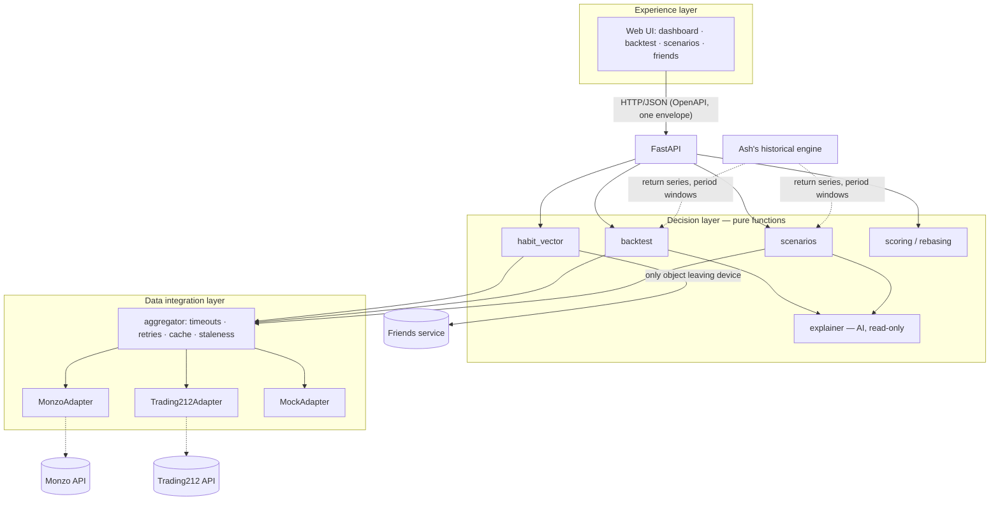

# Architecture

Three layers. The API is thin; decisions are pure functions; all I/O sits behind adapters.

## Request walkthrough

Example: `POST /v1/backtest`.

1. **UI** (`static/app.js`) sends JSON to `/v1/backtest`. No framework, no build step.
2. **Middleware** assigns a request ID (also returned as `X-Request-ID`).
3. **API route** validates the body with pydantic. Bad input becomes a `validation_error` envelope.
4. **Dependency `get_snapshot`** calls `build_adapters(settings)` and then the **aggregator** (`fetch_snapshot`). The aggregator fetches Monzo and Trading212 concurrently, with a timeout and bounded retries per source.
5. **Adapters** (`MonzoAdapter`, `Trading212Adapter` or `MockAdapter`) return domain models only. Vendor JSON never passes this point.
6. **Decision layer** runs pure functions on the snapshot: `habit_vector`, `backtest`, `scenarios`, scoring. If the user gave no monthly contribution, it is derived from the last 6 months of savings transfers (fallback £100).
7. **Envelope**: `ok(data, request, snapshot)` wraps the result. `meta` carries `request_id`, `as_of`, `stale` and per-source status.
8. Errors at any step (HTTP errors, validation, `SourceError`, unexpected exceptions) go through the same envelope. Unexpected errors return `internal_error` with no internals.

`/v1/explain` is the only place an LLM is involved. It receives a result the engine already computed, and its text is rejected if it contains numbers that are not in the input. Without an API key a template is used.

## Privacy boundary

Stays on the device: transactions, balances, holdings, merchants, all pound values (including the dashboard payload and the local part of backtest results).

May leave the device (the `FriendCard`):

- habit vector scores (0 to 100) and the overall score
- a rebased time-weighted return index (starts at 100, no amounts)
- an **opt-in** pie of asset-class percentages

`GET /v1/friends/me/card` returns exactly this payload. The card model has no money fields, and tests check that the serialised card contains none of the snapshot's amounts. Raw habit factor values are rounded to 3 decimals so exact ratios cannot be used to back out amounts. `include_local=false` on `/v1/backtest` omits pound results.

Credentials (Monzo tokens, Trading212 key and secret) also stay local. They are saved to `data/private/credentials.json` (mode 0600, gitignored) when "Remember on this device" is on (the default), otherwise held in memory only. They are sent only to the provider they belong to, never logged, and never returned by the API (status shows a masked hint). Live data is cached under a live-specific key so a failing live source can never fall back to cached demo data.

## Slow and bad data

- Per-source timeout and bounded retries with backoff, for retryable errors only.
- Records that fail validation are dropped and counted (`dropped` in the source status). One bad record does not fail the fetch.
- Each good fetch is cached on disk. If a source fails, its cached data is served with `stale: true` and the original `as_of`.
- With no cache, the source is reported `ok: false` and the rest of the snapshot is still returned. The API answers 200 with the status in `meta.sources`.
- The UI shows a visible "stale" warning and a badge per source.
- The mock adapter can inject latency, failures and corrupt records to test all of this.

## Trade-offs

| Decision | Why | Cost |
|---|---|---|
| One adapter interface with capability flags, rather than one interface per source type | The mock can stand in for any source, and the aggregator stays simple | Some methods raise `UnsupportedCapability` on some adapters |
| Money stored as integer pence | No float rounding errors in sums or caps | Values are converted at the edges for display |
| Decision layer is pure, with no I/O | Fast deterministic tests. Easy to reason about | The aggregator has to fetch everything up front |
| Partial results plus a stale cache instead of hard failure | The demo survives a slow or failing API | The UI has to show which sources are stale |
| Time-weighted return index rebased to 100 for comparisons | People with different incomes can be compared fairly and privately | Hides absolute outcomes, which stay local only |
| Synthetic returns first, real series later | Unblocks the backtest immediately | Early results are illustrative only |
| AI explains results but never decides | Numbers stay auditable. No hallucinated figures | Explanations are less flexible. Template fallback when offline |
| Server-side friends data is mocked | A real friends service needs hosting and pairing (open question 14) | The leaderboard uses mock personas, so ranks are illustrative |
| Vanilla JS UI with Chart.js from a CDN | No build step, easy to run in a hackathon | Needs internet for the chart library |
| Friends index uses a fixed 80/20 strategy | Same comparison for everyone, no amounts involved | Does not reflect each person's own allocation |
