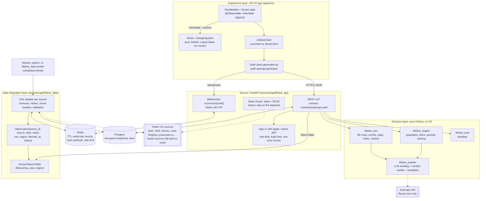

# Architecture

Lifeline has three layers, as the brief requires: experience, decision and data integration. A FastAPI service joins them. This page describes the target design from `BUILD_SPEC.md` and the code paths that implement it.

## System diagram

## Layers

### Experience: `apps/ios`

- SwiftUI app for iOS 26. Uses system `TabView`, glass button styles and `GlassEffectContainer`.
- XcodeGen builds the project from `apps/ios/project.yml`.
- `swift-openapi-generator` builds the network client from `contracts/openapi.yaml`.
- The app talks only to our backend. It holds no keys.
- Networking sits behind `protocol LifelineClient` (ADR 0011):
  - `LiveClient` wraps the generated OpenAPI client and calls the API.
  - `MockClient` returns contract examples and fixtures instantly, with no backend.
  - Selection: launch argument `-mockClient` or the Debug-menu toggle, else the build setting `LIFELINE_CLIENT` (`live` in Debug and Release, `mock` in the `Mock` configuration).
- Each screen has three parts (ADR 0011):
  - `Features/<Feature>/ViewModels/<Screen>ViewModel.swift`: `@MainActor @Observable`, calls `LifelineClient`, exposes a plain `<Screen>ViewState`. Agent-owned.
  - `Features/<Feature>/Views/<Screen>View.swift`: a pure view of the ViewState and action closures. It never calls the network. Owned by the UI owner (a human).
  - `Features/<Feature>/<Screen>Screen.swift`: glue that owns the ViewModel and passes state and closures to the View. Agent-owned.
- `Features/**/Views/**` and `DesignSystem/**` belong to the UI owner. Agents never edit them. An agent that needs a view change adds a request to `docs/UI_REQUESTS.md`.
- The `Playground` scheme runs the `Mock` configuration with `-playground`. It opens a gallery of every screen and fixture state, backed by `MockClient`.
- Demo sign-in: launch argument `-demoDeviceID <id>`, or the Debug menu (long-press the version label on character select) with "Use presenter id".

### Decision: `lifeline_engine`, `lifeline_sim`, `lifeline_eval`, `lifeline_explain`

- `lifeline_engine` and `lifeline_sim` are pure. They do no network, database or clock calls. They take a seeded RNG as an argument.
- Same `MacroTable` plus same seed gives the same life (ADR 0005).
- The Index compares the player with an "autopilot" twin (same character, same seed, default choices). The formula is in `docs/index.md`.
- `lifeline_explain` asks the LLM for wording only. A verifier extracts every number from the LLM text. Each number must match an engine fact, or the deterministic template is used.

### Data integration: `lifeline_data`

1. Each adapter fetches one source and maps it to `Observation` rows.
2. Redis caches the rows with a TTL per source.
3. Postgres keeps the last good snapshot.
4. The hub reduces observations to an annual `MacroTable`.
5. Every value carries a status: `live`, `cached` or `mock`.

A source that fails serves `cached` data. A source with no key, or with no cached data, serves labelled `mock` data. A source that excludes Scotland uses the UK value with the note "UK average used".

### Service: `lifeline_api`

- Routes follow `contracts/openapi.yaml`. The contract is generated from `lifeline_contracts` Pydantic models (ADR 0002).
- One error format: `{"error": {"code": "...", "message": "...", "source": "..."}}`.
- Same Life rooms use a WebSocket per room. Redis pub/sub fans out rival updates across API processes.
- Bank OAuth: the app opens a backend consent link. The provider redirects to the backend. The backend exchanges the code and redirects to `lifeline://connected?status=ok`. Tokens never reach the device.

## Runtime (docker compose)

| Service | Image | Command | Depends on |
|---|---|---|---|
| `api` | `services/api/Dockerfile` | `uvicorn lifeline_api.main:app` on port 8000 | postgres, redis (healthy) |
| `worker` | same image | `python -m lifeline_data.worker` | postgres, redis (healthy) |
| `postgres` | `postgres:16-alpine` | default | none |
| `redis` | `redis:7-alpine` | default | none |

- The image has two stages. The build stage runs `uv sync --frozen --no-dev`. The runtime stage copies `/app` and runs as non-root user `app` (uid 10001).
- The image includes `seed/`, so `make demo-seed` runs `python -m seed.load` inside the `api` container.

## Request flow: one AGE tap

1. The app sends `POST /v1/lives/{id}/age` with the JWT.
2. The API loads the life from Postgres and the `MacroTable` (by stored hash) from the data hub.
3. `lifeline_sim` advances one year with the life's seed and returns new events with engine facts.
4. `lifeline_explain` optionally rewrites the event text. The verifier checks every number.
5. The API stores the life and returns `AgeResult`. If the life is in a room, the app sends a `progress` message on the WebSocket and the server broadcasts a `rival` update.

## Trade-offs

See the trade-offs table in `README.md`.
