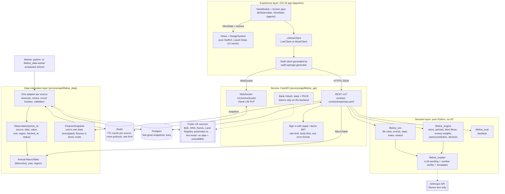
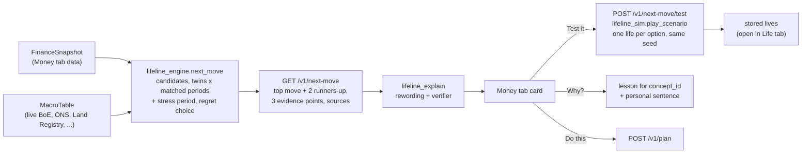

# Architecture

Penny has three layers, as the brief requires: experience, decision and data integration. A FastAPI service joins them. This page describes the target design from `BUILD_SPEC.md` and the code paths that implement it.

## System diagram

## Layers

### Experience: `apps/ios`

- SwiftUI app for iOS 26. Uses system `TabView`, glass button styles and `GlassEffectContainer`.
- Tabs: Money (home, opens first), Life (the game), Play (rooms, challenges, ribbons, concepts), You (profile, bank, settings) (ADR 0016). The Next Move card is the first element on Money.
- XcodeGen builds the project from `apps/ios/project.yml`.
- `swift-openapi-generator` builds the network client from `contracts/openapi.yaml`.
- The app talks only to our backend. It holds no keys.
- Networking sits behind `protocol LifelineClient` (ADR 0011):
  - `LiveClient` wraps the generated OpenAPI client and calls the API.
  - `MockClient` returns contract examples and fixtures instantly, with no backend.
  - Selection: launch argument `-mockClient` or the Debug-menu toggle, else the build setting `LIFELINE_CLIENT` (`live` in Debug and Release, `mock` in the `Mock` configuration).
- Each screen has three parts (ADR 0011):
  - `Features/<Feature>/ViewModels/<Screen>ViewModel.swift`: `@MainActor @Observable`, calls `LifelineClient`, exposes a plain `<Screen>ViewState`. Agent-owned.
  - `Features/<Feature>/Views/<Screen>View.swift`: a pure view of the ViewState and action closures. It never calls the network. Owned by the UI owner (a human).
  - `Features/<Feature>/<Screen>Screen.swift`: glue that owns the ViewModel and passes state and closures to the View. Agent-owned.
- `Features/**/Views/**` and `DesignSystem/**` belong to the UI owner. Agents never edit them. An agent that needs a view change adds a request to `docs/UI_REQUESTS.md`.
- The `Playground` scheme runs the `Mock` configuration with `-playground`. It opens a gallery of every screen and fixture state, backed by `MockClient`.
- Demo sign-in: launch argument `-demoDeviceID <id>`, or the Debug menu (long-press the version label on character select) with "Use presenter id".

### Decision: `lifeline_engine`, `lifeline_sim`, `lifeline_eval`, `lifeline_explain`

- `lifeline_engine` and `lifeline_sim` are pure. They do no network, database or clock calls. They take a seeded RNG as an argument.
- Same `MacroTable` plus same seed gives the same life (ADR 0005).
- The Index compares the player with an "autopilot" twin (same character, same seed, default choices). The formula is in `docs/index.md`.
- `lifeline_engine.money` turns a `FinanceSnapshot` into Money tab insights: categories, subscriptions, bills, budgets, goals, the profile and personal facts for lessons (ADR 0016). No LLM.
- `lifeline_engine.money.predict` predicts today's spend with ridge regression and explains it in £ per feature group (ADR 0017).
- `lifeline_engine.next_move` ranks money moves (ADR 0018, 0020, 0023). See "Next Move flow" below.

### Explain layer: `lifeline_explain` (ADR 0019)

1. The engine or sim produces a deterministic template text plus `facts` (the numbers behind it).
2. The LLM (`LLM_MODEL`, default `claude-opus-5-5`, ADR 0007) may reword `Event.text`, `Outcome.text`, and the Next Move `headline`, `action` and evidence text. Numbers, options, sources and `confidence_label` never pass through it.
3. The verifier extracts every number from the LLM text. Each must match an allowed value: an engine fact, a number in the template text, the year or age, or (for moves) impact, worst case, confidence, `days_left` and test-period years. Match rule: same value at the written precision, or within 0.5%.
4. Any unmatched number rejects the text. Events and outcomes fall back to the whole template. Moves fall back per field.
5. One call, no retry, hard timeout (`LLM_TIMEOUT_SECONDS`). Refusal, bad JSON or timeout gives the template.
6. Results are cached in Redis for 30 days and verified again on every cache hit. `LLM_ENABLED=0` forces templates.

### Data integration: `lifeline_data`

1. Each adapter fetches one source and maps it to `Observation` rows.
2. Redis caches the rows with a TTL per source.
3. Postgres keeps the last good snapshot.
4. The hub reduces observations to an annual `MacroTable`.
5. Every value carries a status: `live`, `cached` or `unavailable`. `mock` exists only in demo mode (ADR 0027).

Context-only sources (ADR 0030): Guardian headlines (`GET /v1/news`, headline and link only, no body text) and Bank of England MPC rate-decision dates (`GET /v1/rate-decisions`, the "Next Bank of England rate decision" line in Next Move "Why?"). They never feed the `MacroTable` or any engine result; a test asserts that `next_move` output is identical with and without them. Headlines are untrusted text (ADR 0034).

A source that fails serves `cached` real data. A source with no key, or with no cached data:

- Live mode (`DATA_MODE=live`, Railway): `unavailable`. Its values are absent from the `MacroTable`, and events that need them do not fire.
- Demo mode (`DATA_MODE=demo`, local default and tests): labelled `mock` data.

A source that excludes Scotland uses the UK value with the note "UK average used".

### Service: `lifeline_api`

- Routes follow `contracts/openapi.yaml`. The contract is generated from `lifeline_contracts` Pydantic models (ADR 0002).
- One error format: `{"error": {"code": "...", "message": "...", "source": "..."}}`.
- Same Life rooms use a WebSocket per room. Redis pub/sub fans out rival updates across API processes.
- Bank OAuth: the app opens a backend consent link. The provider redirects to the backend. The backend exchanges the code and redirects to `lifeline://connected?status=ok`. Tokens never reach the device.

## Money tab (ADR 0016, 0017)

1. `lifeline_data.finance` builds a `FinanceSnapshot` (accounts, transactions, mortgage and energy details, holder) for the signed-in subject. Live mode: only the user's own data (statement upload, manual entry; Monzo and Trading212 after the Yaffy merge, ADR 0036), stored encrypted in Postgres. With no data, `GET /v1/finance/home` returns `has_data: false` (ADR 0038). Demo mode: one of four labelled fixture personas, chosen by subject (`demo-presenter-01` maps to `homeowner-leeds`). TrueLayer is disabled (ADR 0027).
2. `lifeline_engine.money` computes the insights. The API serves them under `/v1/finance/*`: overview, spending, subscriptions, bills, budgets, goals, profile, prediction, guesses.
3. Every response has `meta.data_status`. Mock data (demo mode only) shows "Sample data".
4. `/v1/finance/profile` returns a `DecisionProfile` and a `CharacterSpec`. The Next Move, the Real-life Decision and "Play yourself" all use this one profile, so they agree.

## Next Move flow (ADR 0018, 0020, 0022, 0023)

1. **Inputs.** The finance snapshot's `as_of` is "today" for every engine call, so one snapshot always gives the same answer (ADR 0022). The `MacroTable` holds live and cached source values.
2. **Candidates.** A move is a candidate only when the data supports it. Example: `fix_mortgage` needs a fixed deal that ends within 12 months.
3. **Scoring.** For each option, the engine simulates twins (similar synthetic people) through matched past periods and through the standard stress period for that move kind (mortgages and energy 2021-2023; savings 2009-2011; debt and emergency fund 2008-2010). The option with the highest `expected - 0.5 x max regret` wins (ADR 0020). Confidence is the share of (twin, period) pairs where that option was the best of the move's options (ADR 0023).
4. **Ranking.** Moves are ranked by `impact + 0.5 x min(0, worst case)`, scaled by confidence. Ties prefer the nearer deadline.
5. **Card.** One top move and up to two runners-up. Each has 3 evidence points whose numbers appear in `facts`. Evidence point 3 states the stress result of the recommended option and of the best alternative.
6. **Test it.** `lifeline_sim.play_scenario` plays the user's profile through `test_period` once per option. Seed = sha256(subject + move id), so a repeat gives the same lives. The character's birth year shifts so the user is today's age at the period start. The response compares net worth path, total cost, missed payments, worst year and Index per option.
7. **Do this.** `POST /v1/plan` stores the move in the user's plan (`user_docs` table). Adding the same move twice keeps one item.
8. **Backtest.** `NextMoveResponse.backtest` reports the hit rate over past deal-end years against "always fix 2 years" and the best constant rule "always take a tracker" (`docs/prediction.md`).

## Runtime (docker compose)

| Service | Image | Command | Depends on |
|---|---|---|---|
| `api` | `services/api/Dockerfile` | `uvicorn lifeline_api.main:app` on port 8000 | postgres, redis (healthy) |
| `worker` | same image | `python -m lifeline_data.worker` | postgres, redis (healthy) |
| `postgres` | `postgres:16-alpine` | default | none |
| `redis` | `redis:7-alpine` | default | none |

- The image has two stages. The build stage runs `uv sync --frozen --no-dev`. The runtime stage copies `/app` and runs as non-root user `app` (uid 10001).
- The image includes `seed/`, so `make demo-seed` runs `python -m seed.load` inside the `api` container.

## Request flow: one AGE tap

1. The app sends `POST /v1/lives/{id}/age` with the JWT.
2. The API loads the life from Postgres and the `MacroTable` (by stored hash) from the data hub.
3. `lifeline_sim` advances one year with the life's seed and returns new events with engine facts.
4. `lifeline_explain` optionally rewrites the event text. The verifier checks every number.
5. The API stores the life and returns `AgeResult`. If the life is in a room, the app sends a `progress` message on the WebSocket and the server broadcasts a `rival` update.

## Trade-offs

See the trade-offs table in `README.md`.
